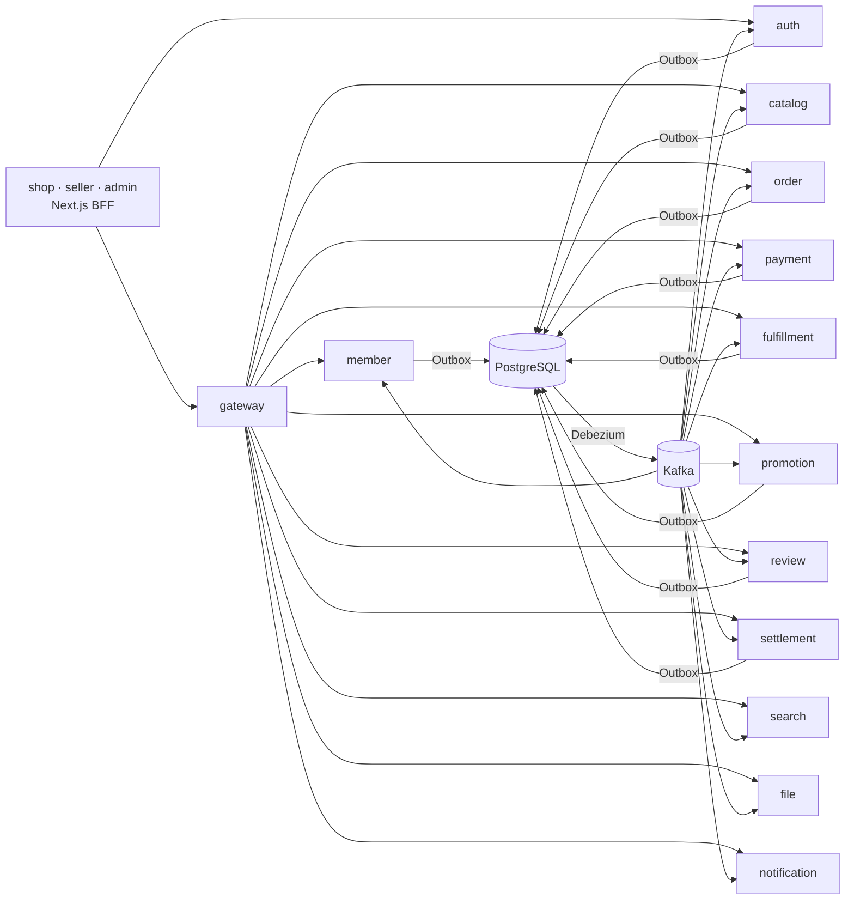

# Open Market

여러 판매자가 입점하는 오픈 마켓을 **실제로 운영할 수 있는 수준**으로 만드는 풀스택 프로젝트입니다.
상품 등록부터 검색, 주문, 결제, 배송, 반품·환불, 쿠폰, 리뷰, 판매자 정산까지 전 과정을 다룹니다.

> 현재 단계: **M0 기반 완료**(빌드, 로컬 인프라, 이벤트 파이프라인, 관측성, 프론트 골격, CI). 다음은 **M1 회원·인증·판매자 입점**입니다. 진행 상황은 [로드맵](docs/roadmap.md)에 있습니다.

## 기술 스택
| 영역 | 사용 기술 |
|---|---|
| 백엔드 | Java 25, Spring Boot 4, Spring Data JPA, QueryDSL, Spring Cloud (Gateway, Eureka, Config) |
| 인증 | Spring Authorization Server (OAuth2 / OIDC), Next.js BFF |
| 메시징 | Kafka, Transactional Outbox, Debezium CDC, 코레오그래피 Saga |
| 데이터 | PostgreSQL(서비스별 스키마), Redis, Elasticsearch(nori) |
| 프론트엔드 | Next.js (App Router), TypeScript, pnpm 모노레포 |
| 관측성 | OpenTelemetry, Prometheus, Grafana, Tempo, Loki |
| 결제 | 토스페이먼츠 (테스트 환경) |
| 실행 | Docker Compose (로컬, 비용 0) |

## 아키텍처


| 구분 | 서비스 |
|---|---|
| core | member, catalog, order, payment, fulfillment, promotion, review, settlement, search |
| infra | gateway, discovery, config, auth, file, notification |
| clients | shop(구매자), seller(판매자), admin(관리자) |

자세한 설계는 [아키텍처 개요](docs/architecture/overview.md)와 [컨텍스트 맵](docs/architecture/context-map.md)에 있습니다.

## 설계에서 다루는 문제
- **분산 정합성**: 재고 예약 → 쿠폰 예약 → 결제 → 배송 생성으로 이어지는 주문 Saga와 보상 흐름 ([메시징과 Saga](docs/architecture/messaging.md))
- **이벤트 유실 방지**: DB 커밋과 이벤트 발행을 Outbox + CDC로 원자화, 멱등 소비자 ([ADR 0003](docs/adr/0003-outbox-debezium.md))
- **동시성**: 재고 초과 판매 방지, 선착순 쿠폰 초과 발급 방지
- **결제 경쟁 조건**: 결제 승인과 주문 만료가 겹칠 때 자동 보상 취소
- **보안**: 브라우저에 토큰을 두지 않는 BFF, 서비스 간 `client_credentials` ([인증·인가](docs/architecture/auth.md))
- **관측성**: Gateway부터 Kafka 소비자까지 이어지는 분산 트레이스 ([관측성](docs/architecture/observability.md))

## 문서
| 문서 | 내용 |
|---|---|
| [PRD](docs/prd.md) | 사용자 유형, 기능 요구사항, 비기능 요구사항 |
| [용어집](docs/glossary.md) | 도메인 용어와 코드 이름 |
| [로드맵](docs/roadmap.md) | 마일스톤 M0~M6과 완료 기준 |
| [아키텍처](docs/architecture/overview.md) | 서비스 구성, 통신, 데이터, 규약 |
| [ADR](docs/adr/README.md) | 주요 결정과 근거 |
| [개발 환경](docs/dev-setup.md) | 로컬 실행 준비 |

## 실행
도구, WSL 메모리, hosts 준비는 [개발 환경](docs/dev-setup.md)에 있습니다.

```bash
cp .env.example .env
docker compose --profile obs --profile apps up -d --wait --build
curl -i -X POST localhost:8080/api/auth/v1/accounts -H 'Content-Type: application/json' -d '{"email":"buyer@example.com","password":"buyer-pass-1234","name":"구매자"}'   # gateway 경유 가입. 인증 메일은 Mailpit(http://localhost:8025)
```

포트, 화면 주소, 서비스를 IDE로 띄우는 방법은 [개발 환경](docs/dev-setup.md)의 "실행" 절에 있습니다.

## 성능 개선 기록
k6 부하 테스트로 측정한 개선 내역입니다. (M2부터 기록)

| 대상 | 문제 | 개선 | 전 | 후 |
|---|---|---|---|---|
| 상품 상세(catalog), 조회·검색 초당 600건 | 요청마다 카테고리 경로를 한 단계씩 따로 조회해 DB를 5~6번 왕복, 연결 풀 대기 최대 162 | 카테고리를 처음 쓸 때 한 번 읽어 메모리에 둔다(상세는 DB 3번) | 상세 p95 1,425ms, 보내지 못한 요청 22,861 | 상세 p95 1,204ms, 8,599 |
| gateway·catalog JVM, 조회·검색 초당 600건 | 컨테이너가 2GB 미만이라 JVM이 SerialGC를 골라 모든 요청이 함께 멈춤(gateway 멈춤 평균 59ms, 부하 구간의 약 9%) | 두 서비스만 ParallelGC | 상세 p95 1,204ms, 검색 1,054ms | 상세 371ms, 검색 276ms, 보내지 못한 요청 2,144 |
| 선착순 쿠폰(promotion), 1,000건 동시 | 매진 응답도 쿠폰을 읽느라 DB 연결(5개)을 기다림. 연결 획득 최대 6.5s | 발급용 쿠폰 조회를 메모리에 두고 1초마다 뒤에서 새로 읽는다. 최종 판정은 DB 조건부 UPDATE | p50 5.6s, p95 7.5s | p50 2.6s, p95 3.7s(gateway ParallelGC 포함) |

측정 방법과 남은 병목은 [risks.md](docs/architecture/risks.md) "부하 측정"에 있습니다.
