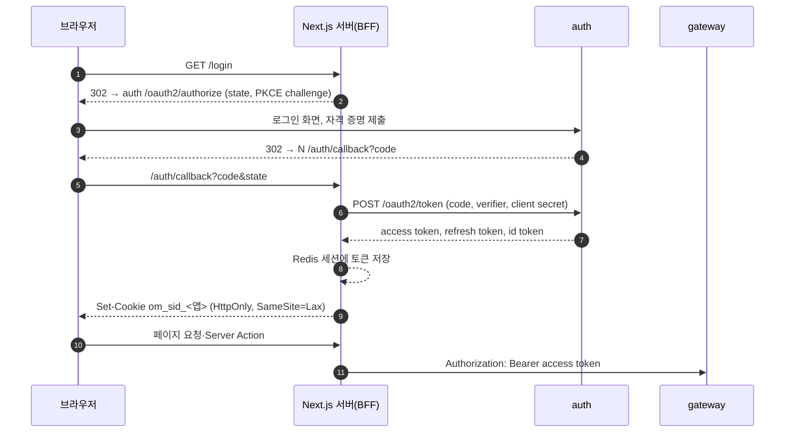

# 인증·인가

## 구성
| 구성 요소 | 역할 |
|---|---|
| auth | Spring Authorization Server. 로그인 화면, 가입 API, 계정·역할, OAuth2 클라이언트 등록, JWT 발급, JWK 공개 |
| Next.js 서버(BFF) | OAuth2 클라이언트. 토큰을 서버 세션(Redis)에 두고, 브라우저에는 세션 쿠키만 준다 |
| gateway | 리소스 서버. JWT 검증, 경로별 역할 검사, 레이트 리밋 |
| 각 서비스 | 리소스 서버. JWT를 다시 검증하고, 리소스 소유권(내 주문, 내 상품)을 검사한다 |

## 로그인 흐름 (Authorization Code + PKCE)

- 세 앱은 각각 기밀 클라이언트(`shop`, `seller`, `admin`)다. 클라이언트 시크릿은 Next.js 서버 환경 변수에만 둔다.
- 액세스 토큰이 만료되면 BFF가 리프레시 토큰으로 갱신한다. 리프레시 토큰은 쓸 때마다 새로 발급한다(rotation).
- 로그아웃하면 BFF 세션을 지우고, 리프레시 토큰을 폐기(revoke)한 뒤, auth의 OIDC 로그아웃 엔드포인트로 보낸다.
- 가입은 shop의 화면에서 받는다. BFF가 auth 가입 API(`POST /api/auth/v1/accounts`, 공개, 레이트 리밋 적용)를 부른다. 로그인 화면만 auth가 그린다.
- 가입하면 인증 메일이 나간다(`EmailVerificationRequested` → notification). 링크는 shop 화면(`/verify-email?token=`)이고, BFF가 `POST /api/auth/v1/accounts/email-verification`을 부른다. 인증 전에도 로그인할 수 있지만 주문은 할 수 없다. 재발송은 `POST /api/auth/v1/accounts/email-verification/resend`이고 가입 여부와 상관없이 202다.
- BFF 구현은 `clients/packages/bff`(openid-client + Redis)다. 라우트, 쿠키, 갱신 락은 [ADR 0014](../adr/0014-bff-session.md)에 있다.

## 토큰
| 항목 | 값 |
|---|---|
| 형식 | JWT, RS256 |
| 액세스 토큰 수명 | 10분 |
| 리프레시 토큰 수명 | shop·seller 14일, admin 8시간 |
| `sub` | `accountId` (= `memberId` = 판매자면 `sellerId`) |
| `roles` | `BUYER`, `SELLER`, `ADMIN` 중 보유한 것 |
| `email_verified` | 이메일 인증을 마쳤는지(사용자 토큰). 주문은 `true`여야 한다(ACC-1) |
| `aud` | 클라이언트 ID. 서비스 간 토큰은 `internal` |
| `scope` | 사용자 토큰 `openid profile api`, 서비스 간 토큰 `internal` |

- 서명 키는 auth 스키마에 저장한다. 처음 기동할 때 만들고, 회전하면 이전 키를 JWK 세트에 일정 기간 남긴다.
- 역할이 바뀌면(입점 승인, 판매자 정지) 다음 토큰 갱신부터 반영된다. 최대 지연은 액세스 토큰 수명(10분)이다. 판매자 정지는 catalog가 상품을 바로 판매 중지하므로, 그 사이에 판매가 일어나지 않는다.
- admin 클라이언트는 `ADMIN` 역할이 없는 계정의 인가 요청을 거절한다. 관리자는 비밀번호 다음에 TOTP를 확인한다(아래 "관리자 2단계 인증").

## 인가
1. **gateway**: 서명, `iss`, `exp`, `aud`(`shop`, `seller`, `admin` 중 하나)를 검증한다. 경로 접두어로 역할을 검사한다. `/v1/seller/**`는 `SELLER`, `/v1/admin/**`는 `ADMIN`이 필요하다. 공개 경로는 config-repo `gateway.yml`의 `openmarket.gateway.public-paths`에 적고, 나머지는 토큰이 있어야 한다. 서비스의 `/internal/**`, `/actuator/**`, OpenAPI 문서(`/v3/api-docs`)는 넘기지 않는다. 바깥에서 들어온 내부 헤더(`X-Internal-*`)는 지운다. 규칙 순서와 근거는 [ADR 0011](../adr/0011-gateway-webflux.md).
2. **서비스**: 같은 검증을 한 번 더 한다. gateway를 우회한 호출도 막기 위해서다. `services/libs/common-security`(자동설정)가 맡는다. `/internal/**`는 `internal` scope, `/v1/seller/**`는 `SELLER`, `/v1/admin/**`는 `ADMIN`, 나머지 `/v1/**`는 역할이 있는 사용자 토큰이 필요하고, 그 밖의 경로는 막는다(actuator, OpenAPI 문서, `/error`는 연다). 서비스 간 토큰은 역할이 없어 `/v1`을 부르지 못한다. 토큰 없이 여는 서비스 경로(공개 이미지 `/files/**`, 상품 조회)는 config-repo `<service>.yml`의 `openmarket.security.public-paths`(메서드, 서비스 기준 패턴)에 적는다. 역할·내부 경로는 여기에 적어도 열리지 않는다. gateway의 `public-paths`에도 gateway 기준 경로로 같이 적어야 바깥에서 열린다. 소유권은 유스케이스에서 검사한다(예: 하위 주문의 `sellerId`가 토큰의 `sub`와 같은지).
   - auth는 common-security를 쓰지 않는다. `/v1/**` 체인이 가입 API만 열고, 관리자 API(`/v1/admin/**`, DLT 메시지)는 auth가 발급한 액세스 토큰의 `roles`에 `ADMIN`이 있어야 한다. 토큰이 없으면 401, 그 밖의 막힌 경로는 403이다.
3. **서비스 간 호출**: 각 서비스는 자기 이름을 클라이언트 ID로 쓰는 `client_credentials` 토큰을 받는다. 내부 API는 `/internal/v1/**`에 두고 `internal` scope를 요구한다. gateway는 `/internal/**`를 라우팅하지 않는다.

## 보안 기본값
- 비밀번호는 `DelegatingPasswordEncoder`(기본 bcrypt)로 저장한다.
- 로그인 실패, 계정 잠금, 2단계 코드 실패, 레이트 리밋 초과는 보안 이벤트 로그로 남긴다([observability.md](observability.md) "보안 이벤트").
- 로그인 5회 연속 실패 시 15분 잠금(ACC-1). 로그인과 가입은 IP 단위 레이트 리밋을 건다(NFR-5).
  - 가입 API는 gateway를 거치므로 gateway에서 제한한다.
  - 로그인 화면은 브라우저가 auth에 직접 가므로 gateway를 거치지 않는다. auth가 로그인 처리 앞에서 Redis로 IP 단위 제한을 건다. 경로는 폼 로그인과 같이 디코딩해서 맞춘다(`/%6Cogin`도 `/login`이다).
- CSRF: BFF 세션 쿠키는 `SameSite=Lax`로 둔다. Server Action은 Next.js가 Origin을 검사하고, 상태를 바꾸는 Route Handler(로그아웃, 파일 업로드)는 `bff.isSameOrigin`으로 직접 검사한다. auth 로그인 화면은 Spring Security CSRF 토큰을 쓴다.
- 세션 쿠키는 운영 기준과 같게 `HttpOnly`를 켠다. `Secure`는 로컬 HTTP에서 끄고 설정으로 바꿀 수 있게 한다.
- BFF 세션 수명(shop·seller 14일, admin 8시간)은 로그인 시각부터 센다. 리프레시 토큰은 rotation마다 수명이 다시 시작되므로, 토큰을 갱신해도 세션은 늘리지 않는다. 지나면 다시 로그인한다.
- 앱 3개는 모든 응답에 `Content-Security-Policy: frame-ancestors 'none'`, `X-Frame-Options: DENY`, `X-Content-Type-Options: nosniff`, `Referrer-Policy: strict-origin-when-cross-origin`을 붙인다(`@openmarket/config/next-headers`). Spring 서비스와 auth는 Spring Security 기본 헤더를 쓴다.

## 관리자 2단계 인증(M6)
`ADMIN` 역할 계정은 비밀번호 다음에 TOTP(RFC 6238) 코드를 확인해야 로그인이 끝난다. Spring Security 7 다중 요소 인증의 요소 권한(`FACTOR_TOTP`)으로 요구한다([ADR 0024](../adr/0024-admin-totp-mfa.md), R15).
- 대상: `ADMIN` 역할이 있는 계정은 어느 클라이언트(shop, seller, admin)로 로그인하든 거친다. 토큰의 `roles`에 `ADMIN`이 실리므로 클라이언트로 나누지 않는다. 다른 계정은 바뀌지 않는다.
- 흐름: 비밀번호가 맞으면 아직 인가 코드를 내지 않고 auth의 TOTP 화면(`/login/totp`)으로 보낸다. 인가 엔드포인트 체인의 권한 규칙이 ADMIN 로그인에 `FACTOR_TOTP` 요소를 요구하고, 없으면 인가 요청을 저장해 이 화면으로 보낸다. 코드가 맞으면 인증에 요소를 더하고 세션 ID를 바꾼 뒤 저장한 인가 요청으로 돌아간다. 리프레시 토큰 갱신은 다시 묻지 않는다(admin 리프레시 토큰 8시간).
- 등록: 등록하지 않은 관리자는 비밀번호 다음에 등록 화면을 본다. 비밀 값(160비트)을 QR과 문자열(Base32)로 보여 주고, 코드 하나를 맞게 입력해야 등록된다. 등록 전에 화면을 다시 열면 같은 비밀 값이다(코드를 틀려도 다시 스캔하지 않는다). 등록하면 복구 코드 10개(`XXXXX-XXXXX`)를 한 번만 보여 주고 "계속"으로 인가 요청에 돌아간다. 시드 관리자(`ADMIN_SEED_*`)도 첫 로그인 때 등록한다.
- 코드: 6자리, 30초 단계, 앞뒤 한 단계까지 받는다. 마지막으로 받은 단계를 저장해 같은 코드를 다시 받지 않는다.
- 복구 코드: 코드 대신 한 번 쓸 수 있다. 해시만 저장한다. 다 쓰거나 기기를 잃으면 런북의 등록 해제 절차를 따른다.
- 시도 제한: 틀린 코드(등록 확인 포함)는 비밀번호 실패와 같은 횟수에 더해 5회째에 계정을 15분 잠그고 세션을 끝낸다(`/login?locked`). 관리자는 비밀번호가 맞아도 횟수를 지우지 않고 2단계가 맞아야 지운다. TOTP 화면의 `POST`도 `POST /login`과 같은 IP 카운터로 레이트 리밋을 받는다(넘으면 `/login/totp?limited`).
- 저장: 비밀 값은 서명 키와 같은 방식(AES-256-GCM)으로 `AUTH_TOTP_SECRET_KEY`(.env, 서명 키와 다른 값)로 암호화해 `totp_credential`(상태 `PENDING`/`ACTIVE`, 마지막으로 받은 단계)에 둔다. 복구 코드는 bcrypt 해시만 `totp_recovery_code`에 둔다. 키를 바꾸면 `totp_credential`을 지우고 다시 등록한다. 로그에 비밀 값, 코드, 복구 코드를 남기지 않는다.
- 시험 도구: E2E는 등록 화면의 비밀 값 문자열로 코드를 만든다(`clients/e2e/support/totp.ts`, 실행 안에서 `test-results/`에 비밀 값을 둔다). 부하·장애 시험은 `run.sh`가 `infra/k6/admin-totp.js`로 시드 관리자를 한 번 등록하고 비밀 값을 `ADMIN_TOTP_SECRET`으로 시나리오에 넘긴다. 같은 30초 단계는 다시 받지 않으므로 연달아 로그인하면 다음 단계에 한다.

## issuer 호스트 이름
토큰의 `iss`는 브라우저, IDE, 컨테이너 모두에서 같은 주소로 보여야 한다. 근거와 실측은 [ADR 0013](../adr/0013-auth-issuer-host.md)에 있다.
- issuer를 `http://auth.openmarket.local:9000`으로 고정한다. auth는 요청 주소와 상관없이 이 값을 쓴다.
- auth는 컨테이너든 IDE든 호스트 포트 9000에 있다.
- 브라우저와 IDE는 hosts 파일로 `auth.openmarket.local`을 `127.0.0.1`로 보낸다([dev-setup.md](../dev-setup.md) 3절).
- 컨테이너는 `extra_hosts: auth.openmarket.local:host-gateway`로 호스트에 닿는다(gateway, `apps.yaml`).

## auth 구현
코드는 `services/infra/auth`에 있다. 설정은 config-repo `auth.yml`(`openmarket.auth`)이다.
- 클라이언트: `user-clients`(shop, seller, admin)와 `service-clients`(서비스 이름)를 기동할 때마다 DB(`oauth2_registered_client`)에 맞춘다. 행 ID는 클라이언트 ID이고, 시크릿은 바뀌었을 때만 다시 해시한다. 설정에서 빼도 행은 지우지 않는다.
  - 사용자 클라이언트: Authorization Code + PKCE 필수, 동의 화면 없음, 리프레시 토큰 rotation. `required-role`이 있으면 그 역할이 없는 계정의 인가 요청을 `access_denied`로 돌려보낸다(admin은 `ADMIN`).
  - 서비스 클라이언트: `client_credentials`만, scope `internal`. 다른 서비스를 동기 호출하는 서비스만 등록한다.
- 인가·동의: `oauth2_authorization`, `oauth2_authorization_consent`(JDBC). 로그인 세션은 auth 인스턴스의 HTTP 세션이다. 인가·동의 저장소 호출은 트랜잭션 하나로 감싼다. 행을 읽는 도중에 클라이언트를 조회해서, 트랜잭션이 없으면 요청 하나가 연결을 둘 잡고 동시 로그인이 풀 크기를 넘으면 교착된다(risks.md "부하 측정").
- 서명 키: `signing_key` 표. 처음 기동할 때 RSA 2048 키를 만들고, 개인 키는 `AUTH_SIGNING_KEY_SECRET`(.env)으로 AES-256-GCM 암호화해 저장한다. 서명은 가장 최근의 ACTIVE 키로 하고, 헤더에 `kid`를 넣는다. JWK 세트에는 RETIRED가 아닌 키를 모두 싣는다. 회전 작업은 아직 없다.
- `roles`는 토큰을 만들 때마다 DB에서 읽는다. 그래서 갱신하면 바뀐 역할이 반영된다.
- 탈퇴: `member.member`의 `MemberWithdrawn`을 소비한다(`MemberEventsListener`). 계정을 `DEACTIVATED`로 바꾸고, 이메일을 `withdrawn-<id>@withdrawn.invalid`로, 비밀번호 해시를 무작위 값의 해시로 바꾸고, 인가 기록의 리프레시 토큰을 무효로 표시한다(행은 지우지 않는다. OIDC 로그아웃이 `id_token_hint`로 인가 기록을 찾는다). 브라우저에 남은 auth 로그인 세션은 다음 요청에서 `DeactivatedAccountSessionFilter`가 끝낸다. 그 뒤로는 로그인, 인가 코드 발급, 토큰 갱신이 안 되고, 같은 이메일로 새로 가입할 수 있다. 남은 액세스 토큰은 수명(10분)까지 유효하지만 member가 탈퇴한 회원을 404로 다룬다.
- 판매자 역할: `member.seller` 토픽을 소비한다(`SellerEventsListener`). `SellerApproved`, `SellerReinstated`는 `SELLER`를 붙이고 `SellerSuspended`는 뗀다. 이미 그 상태면 그대로다. 계정 행을 잠그고 바꾼다.
- 관리자 계정은 `ADMIN_SEED_EMAIL`, `ADMIN_SEED_PASSWORD`(.env)로 기동할 때 한 번 만든다. 이미 있으면 바꾸지 않는다.
- 로그인 화면은 auth의 Thymeleaf 템플릿(`templates/login.html`)이다. 실패 안내는 계정이 있는지 드러내지 않는다. 잠김(`?locked`)과 시도 초과(`?limited`)는 따로 안내한다.
- 잠금: 비밀번호가 틀리면(`AuthenticationFailureBadCredentialsEvent`) 입력한 이메일의 계정을 행 잠금으로 읽어 센다. 5회째에 15분 잠근다. 잠긴 계정은 비밀번호를 확인하기 전에 거절하므로 잠긴 동안의 시도는 세지 않는다. 폼 로그인에 성공하면 횟수를 지운다. 관리자는 2단계가 맞을 때 지운다(위 "관리자 2단계 인증").
- 로그인 레이트 리밋: `POST /login`과 2단계 확인(`POST /login/totp`, `/login/totp/enroll`)을 한 카운터로 IP마다 1분에 `login-rate-limit.per-minute`(기본 10)회로 제한한다. Redis 고정 창 카운터이고, Redis가 응답하지 않으면 통과시킨다. 넘으면 인증하지 않고 `/login?limited`로 보낸다.
- 가입 레이트 리밋: gateway의 `auth-signup` 라우트(가입, 인증, 인증 메일 재발송)에 기본 한도와 함께 엄격한 한도를 건다. IP마다 1분에 `openmarket.gateway.strict-rate-limit.requests-per-minute`(5)회이고 세 API가 한 버킷을 쓴다. 넘으면 본문 없는 429다. Redis 키는 `strict:` 접두어로 기본 한도와 나눈다.
- 가입 API(`/v1/**`)는 세션·CSRF 없이 공개 경로 세 개만 연다. 나머지 `/v1` 경로는 막는다. 로컬에서는 auth 포트(9000)로도 닿지만, 운영 배치에서는 auth의 `/v1`을 바깥에 열지 않고 gateway로만 받는다(gateway 레이트 리밋을 우회하지 못하게).
- 이메일 인증 토큰은 256비트 무작위 값이다. auth는 SHA-256 해시만 저장하고, 원문은 이벤트의 `verificationUrl`에만 들어간다. 24시간 뒤 만료되고 한 번 쓰면 끝난다. outbox 행은 7일 뒤 지워진다.
- actuator는 관리 포트 9001에만 있다.
