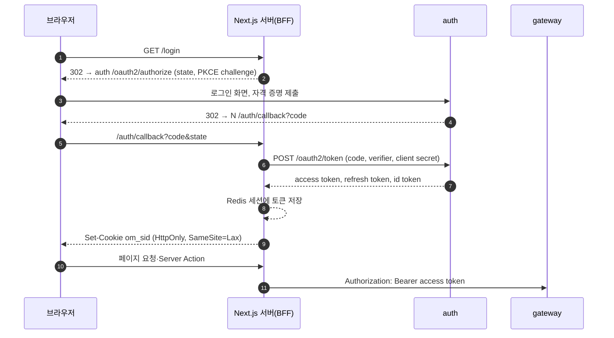

# 인증·인가

## 구성
| 구성 요소 | 역할 |
|---|---|
| auth | Spring Authorization Server. 로그인 화면, 가입 API, 계정·역할, OAuth2 클라이언트 등록, JWT 발급, JWK 공개 |
| Next.js 서버(BFF) | OAuth2 클라이언트. 토큰을 서버 세션(Redis)에 두고, 브라우저에는 세션 쿠키만 준다 |
| gateway | 리소스 서버. JWT 검증, 경로별 역할 검사, 레이트 리밋 |
| 각 서비스 | 리소스 서버. JWT를 다시 검증하고, 리소스 소유권(내 주문, 내 상품)을 검사한다 |

## 로그인 흐름 (Authorization Code + PKCE)

- 세 앱은 각각 기밀 클라이언트(`shop`, `seller`, `admin`)다. 클라이언트 시크릿은 Next.js 서버 환경 변수에만 둔다.
- 액세스 토큰이 만료되면 BFF가 리프레시 토큰으로 갱신한다. 리프레시 토큰은 쓸 때마다 새로 발급한다(rotation).
- 로그아웃하면 BFF 세션을 지우고, 리프레시 토큰을 폐기(revoke)한 뒤, auth의 OIDC 로그아웃 엔드포인트로 보낸다.
- 가입은 shop의 화면에서 받는다. BFF가 auth 가입 API(`POST /api/auth/v1/accounts`, 공개, 레이트 리밋 적용)를 부른다. 로그인 화면만 auth가 그린다.
- BFF 구현 방식(라이브러리 선택)은 M1에서 정한다.

## 토큰
| 항목 | 값 |
|---|---|
| 형식 | JWT, RS256 |
| 액세스 토큰 수명 | 10분 |
| 리프레시 토큰 수명 | shop·seller 14일, admin 8시간 |
| `sub` | `accountId` (= `memberId` = 판매자면 `sellerId`) |
| `roles` | `BUYER`, `SELLER`, `ADMIN` 중 보유한 것 |
| `aud` | 클라이언트 ID. 서비스 간 토큰은 `internal` |
| `scope` | 사용자 토큰 `openid profile api`, 서비스 간 토큰 `internal` |

- 서명 키는 auth 스키마에 저장한다. 처음 기동할 때 만들고, 회전하면 이전 키를 JWK 세트에 일정 기간 남긴다.
- 역할이 바뀌면(입점 승인, 판매자 정지) 다음 토큰 갱신부터 반영된다. 최대 지연은 액세스 토큰 수명(10분)이다. 판매자 정지는 catalog가 상품을 바로 판매 중지하므로, 그 사이에 판매가 일어나지 않는다.
- admin 클라이언트는 `ADMIN` 역할이 없는 계정의 인가 요청을 거절한다. 관리자 2단계 인증(TOTP)은 M6에서 다룬다.

## 인가
1. **gateway**: 서명, `iss`, `exp`, `aud`(`shop`, `seller`, `admin` 중 하나)를 검증한다. 경로 접두어로 역할을 검사한다. `/v1/seller/**`는 `SELLER`, `/v1/admin/**`는 `ADMIN`이 필요하다. 공개 경로는 config-repo `gateway.yml`의 `openmarket.gateway.public-paths`에 적고, 나머지는 토큰이 있어야 한다. 서비스의 `/internal/**`와 `/actuator/**`는 넘기지 않는다. 바깥에서 들어온 내부 헤더(`X-Internal-*`)는 지운다. 규칙 순서와 근거는 [ADR 0011](../adr/0011-gateway-webflux.md).
2. **서비스**: 같은 검증을 한 번 더 한다. gateway를 우회한 호출도 막기 위해서다. 소유권은 유스케이스에서 검사한다(예: 하위 주문의 `sellerId`가 토큰의 `sub`와 같은지).
3. **서비스 간 호출**: 각 서비스는 자기 이름을 클라이언트 ID로 쓰는 `client_credentials` 토큰을 받는다. 내부 API는 `/internal/v1/**`에 두고 `internal` scope를 요구한다. gateway는 `/internal/**`를 라우팅하지 않는다.

## 보안 기본값
- 비밀번호는 `DelegatingPasswordEncoder`(기본 bcrypt)로 저장한다.
- 로그인 5회 연속 실패 시 15분 잠금(ACC-1). 로그인과 가입은 IP 단위 레이트 리밋을 건다.
- CSRF: BFF 세션 쿠키는 `SameSite=Lax`로 둔다. Server Action은 Next.js가 Origin을 검사하고, Route Handler는 직접 Origin을 검사한다. auth 로그인 화면은 Spring Security CSRF 토큰을 쓴다.
- 세션 쿠키는 운영 기준과 같게 `HttpOnly`를 켠다. `Secure`는 로컬 HTTP에서 끄고 설정으로 바꿀 수 있게 한다.

## issuer 호스트 이름
토큰의 `iss`는 브라우저와 컨테이너 양쪽에서 같은 주소로 보여야 한다.
- issuer를 `http://auth.openmarket.local:9000`으로 고정한다.
- 호스트 PC의 hosts 파일에서 `auth.openmarket.local`을 `127.0.0.1`로 보낸다([dev-setup.md](../dev-setup.md)).
- Compose 네트워크에서는 auth 컨테이너에 같은 이름의 네트워크 별칭을 준다.
- 이 방식이 IDE 실행, Compose 실행, Testcontainers에서 모두 동작하는지는 M0에서 확인한다([risks.md](risks.md)).
