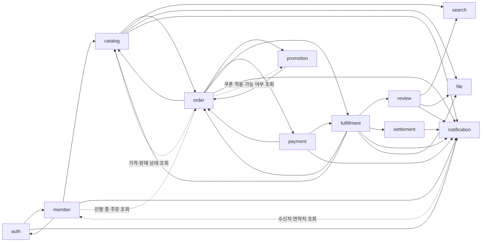

# 컨텍스트 맵과 이벤트 목록

이 문서가 **이벤트 목록의 원본**이다. 이벤트를 추가하거나 바꾸면 여기를 먼저 고친다.
토픽 이름, 봉투 형식, 소비 규칙은 [messaging.md](messaging.md)에 있다.

## 컨텍스트 관계
화살표는 "이벤트를 발행하는 쪽 → 받는 쪽"이다. 점선은 동기 조회(OpenFeign)다.

관계 유형
- auth와 member는 **공유 식별자**(`accountId` = `memberId`)를 쓴다. 자격 증명은 auth, 프로필은 member가 소유한다.
- order는 catalog에 대해 **고객-공급자** 관계다. 주문 당시 가격과 상품명을 스냅샷으로 저장하고, 이후 catalog 변경에 영향을 받지 않는다.
- payment는 토스페이먼츠 앞에 **부패 방지 계층(ACL)** 을 둔다. 토스 응답 형식은 `payment.infra` 밖으로 나가지 않는다.
- search, notification은 **순응자**다. 발행자의 이벤트 형식을 그대로 받아 자기 모델로 바꾼다.

## 이벤트 목록
토픽 이름은 `<발행 서비스>.<집계>`다. Kafka 키는 집계 ID다. 페이로드의 금액은 원 단위 정수다.

### auth.account
| 이벤트 | 시점 | 주요 필드 | 소비자 |
|---|---|---|---|
| `AccountRegistered` | 이메일 가입 완료 | accountId, email, name | member(프로필 생성) |
| `EmailVerificationRequested` | 가입, 재요청 | accountId, email, verificationUrl, expiresAt | notification |
| `AccountEmailVerified` | 인증 완료(처음 한 번) | accountId | member(인증 시각 기록) |

- `name`은 auth가 저장하지 않고 member로 넘기기만 한다. 프로필은 member가 갖는다.
- `verificationUrl`에는 일회용 인증 토큰이 들어 있다. 토큰은 24시간 뒤 만료되고 한 번 쓰면 끝난다. auth는 토큰의 해시만 저장한다. 소비자는 이 값을 로그에 남기지 않는다.

### member.member
| 이벤트 | 시점 | 주요 필드 | 소비자 |
|---|---|---|---|
| `MemberWithdrawn` | 탈퇴 | memberId | auth(계정 비활성화) |

### member.seller
| 이벤트 | 시점 | 주요 필드 | 소비자 |
|---|---|---|---|
| `SellerApproved` | 입점 승인 | sellerId(=memberId), storeName | auth(`SELLER` 역할 추가), notification(M4) |
| `SellerRejected` | 입점 반려 | memberId, applicationId, reason | notification(M4) |
| `SellerSuspended` | 판매자 정지 | sellerId, reason | catalog(전 상품 판매 중지), auth(`SELLER` 역할 회수) |
| `SellerReinstated` | 정지 해제 | sellerId | catalog, auth(`SELLER` 역할 복구) |

### catalog.product
| 이벤트 | 시점 | 주요 필드 | 소비자 |
|---|---|---|---|
| `ProductPublished` | 판매 시작 | 상품 스냅샷(이름, 카테고리, 판매자, SKU·가격, 이미지 fileId) | search, file(첨부 확정) |
| `ProductChanged` | 판매 중 상품 수정 | 상품 스냅샷 | search, file |
| `ProductStopped` | 판매 중지(판매자, 판매자 정지) | productId, reason | search |
| `ProductResumed` | 판매 재개 | productId | search |
| `ProductBanned` | 관리자 제재 | productId, reason | search, notification |

### catalog.stock
| 이벤트 | 시점 | 주요 필드 | 소비자 |
|---|---|---|---|
| `StockReserved` | 주문 재고 예약 성공(전 SKU) | orderId | order |
| `StockReservationFailed` | 하나라도 부족 | orderId, 부족한 skuId 목록 | order |
| `StockAvailabilityChanged` | 품절·재입고 전환 | productId, inStock | search |

### order.order
| 이벤트 | 시점 | 주요 필드 | 소비자 |
|---|---|---|---|
| `OrderPlaced` | 주문 생성(`PENDING`) | orderId, buyerId, 항목(skuId, 수량), 발급 쿠폰 ID 목록 | catalog(재고 예약), promotion(쿠폰 예약) |
| `OrderAwaitingPayment` | 예약 모두 성공 | orderId, 결제 금액, 주문명 | payment(결제 준비) |
| `OrderPaid` | 결제 승인 반영 | orderId, buyerId, 하위 주문 목록(판매자, 항목, 카테고리, 금액, 판매자 쿠폰 부담분), 배송지 스냅샷 | catalog(예약 확정), promotion(쿠폰 사용 확정), fulfillment(배송 생성), notification |
| `OrderCancelled` | 결제 전 취소(예약 실패, 만료, 구매자 취소) | orderId, reason | catalog(예약 해제), promotion(쿠폰 복원), payment(결제 무효화·보상 취소) |

### promotion.issued-coupon
| 이벤트 | 시점 | 주요 필드 | 소비자 |
|---|---|---|---|
| `CouponReserved` | 주문 쿠폰 예약 성공 | orderId | order |
| `CouponReservationFailed` | 사용 불가(만료, 이미 사용) | orderId, reason | order |

### payment.payment
| 이벤트 | 시점 | 주요 필드 | 소비자 |
|---|---|---|---|
| `PaymentApproved` | 토스 승인 성공 | orderId, paymentId, 금액, 수단 | order |
| `PaymentFailed` | 승인 실패 | orderId, 오류 코드 | order, notification |
| `PaymentCancelled` | 전액 취소(보상 포함) | orderId, paymentId, reason | order, notification |
| `RefundCompleted` | 부분취소 성공 | claimId, sellerOrderId, 금액 | fulfillment |
| `RefundFailed` | 부분취소 최종 실패 | claimId, 오류 코드 | fulfillment, notification(관리자) |

### fulfillment.shipment
| 이벤트 | 시점 | 주요 필드 | 소비자 |
|---|---|---|---|
| `ShipmentAccepted` | 발주 확인 | sellerOrderId | order |
| `ShipmentShipped` | 발송 | sellerOrderId, 송장 | order, notification |
| `ShipmentDelivered` | 배송 완료 | sellerOrderId | order, notification |
| `PurchaseConfirmed` | 구매확정(수동·자동) | sellerOrderId, sellerId, buyerId, 항목(orderLineId, productId, 카테고리, 금액), 판매자 쿠폰 부담분 | order, review(작성 자격), settlement(정산 대상) |

### fulfillment.claim
| 이벤트 | 시점 | 주요 필드 | 소비자 |
|---|---|---|---|
| `ClaimRequested` | 신청 | claimId, 유형, sellerOrderId, 첨부 fileId | order, notification(판매자), file |
| `ClaimApproved` | 승인(취소는 즉시) | claimId, 유형, sellerOrderId, 환불 금액 | payment(환불), order |
| `ClaimRejected` | 거부 | claimId, reason | order, notification |
| `ClaimCompleted` | 환불 또는 재발송 완료 | claimId, 유형, sellerOrderId, 재입고 SKU·수량 | order, catalog(재입고), notification |

### review.review, review.rating-summary
| 이벤트 | 토픽 | 시점 | 주요 필드 | 소비자 |
|---|---|---|---|---|
| `ReviewCreated` | review.review | 작성 | reviewId, productId, 첨부 fileId | file, notification(판매자) |
| `RatingSummaryChanged` | review.rating-summary | 작성, 숨김 | productId, 평균 별점, 리뷰 수 | search |

### settlement.settlement
| 이벤트 | 시점 | 주요 필드 | 소비자 |
|---|---|---|---|
| `SettlementConfirmed` | 주간 배치 확정 | settlementId, sellerId, 기간, 금액 | notification |
| `SettlementPaidOut` | 지급 처리 | settlementId, sellerId | notification |

## 이벤트에 넣지 않는 것
- 비밀번호, 토큰, 결제 수단의 상세 정보
- 판매자에게 넘길 필요가 없는 구매자 개인정보. 배송지 스냅샷은 `OrderPaid` → fulfillment로만 간다. notification은 이메일 주소를 member 조회로 얻는다.
- 예외: `EmailVerificationRequested`의 인증 URL은 일회용이고 짧게 만료된다. 이 토픽은 notification만 구독하게 ACL을 건다.
