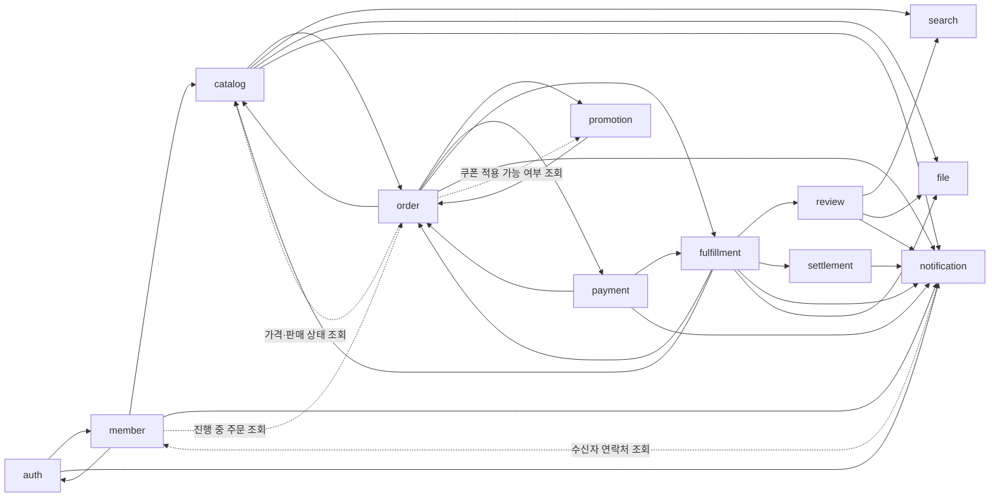

# 컨텍스트 맵과 이벤트 목록

이 문서가 **이벤트 목록의 원본**이다. 이벤트를 추가하거나 바꾸면 여기를 먼저 고친다.
토픽 이름, 봉투 형식, 소비 규칙은 [messaging.md](messaging.md)에 있다.

## 컨텍스트 관계
화살표는 "이벤트를 발행하는 쪽 → 받는 쪽"이다. 점선은 동기 조회(OpenFeign)다.

관계 유형
- auth와 member는 **공유 식별자**(`accountId` = `memberId`)를 쓴다. 자격 증명은 auth, 프로필은 member가 소유한다.
- order는 catalog에 대해 **고객-공급자** 관계다. 주문 당시 가격과 상품명을 스냅샷으로 저장하고, 이후 catalog 변경에 영향을 받지 않는다.
- payment는 토스페이먼츠 앞에 **부패 방지 계층(ACL)** 을 둔다. 토스 응답 형식은 `payment.infra` 밖으로 나가지 않는다.
- search, notification은 **순응자**다. 발행자의 이벤트 형식을 그대로 받아 자기 모델로 바꾼다.

## 이벤트 목록
토픽 이름은 `<발행 서비스>.<집계>`다. Kafka 키는 집계 ID다. 페이로드의 금액은 원 단위 정수다.

### auth.account
| 이벤트 | 시점 | 주요 필드 | 소비자 |
|---|---|---|---|
| `AccountRegistered` | 이메일 가입 완료 | accountId, email, name | member(프로필 생성) |
| `EmailVerificationRequested` | 가입, 재요청 | accountId, email, verificationUrl, expiresAt | notification |
| `AccountEmailVerified` | 인증 완료(처음 한 번) | accountId | member(인증 시각 기록) |

- `name`은 auth가 저장하지 않고 member로 넘기기만 한다. 프로필은 member가 갖는다.
- `verificationUrl`에는 일회용 인증 토큰이 들어 있다. 토큰은 24시간 뒤 만료되고 한 번 쓰면 끝난다. auth는 토큰의 해시만 저장한다. 소비자는 이 값을 로그에 남기지 않는다.

### member.member
| 이벤트 | 시점 | 주요 필드 | 소비자 |
|---|---|---|---|
| `MemberWithdrawn` | 탈퇴 | memberId | auth(계정 비활성화, 이메일 가명 처리, 리프레시 토큰 무효화, 로그인 세션 종료) |

### member.seller
| 이벤트 | 시점 | 주요 필드 | 소비자 |
|---|---|---|---|
| `SellerApproved` | 입점 승인 | sellerId(=memberId), storeName | auth(`SELLER` 역할 추가), catalog(판매자 사본: 상호), notification(M4) |
| `SellerRejected` | 입점 반려 | memberId, applicationId, reason | notification(M4) |
| `SellerSuspended` | 판매자 정지 | sellerId, reason | catalog(판매 중인 상품 모두 판매 중지), auth(`SELLER` 역할 회수) |
| `SellerReinstated` | 정지 해제 | sellerId | catalog(정지로 멈춘 상품만 판매 재개), auth(`SELLER` 역할 복구) |

### catalog.product
| 이벤트 | 시점 | 주요 필드 | 소비자 |
|---|---|---|---|
| `ProductRegistered` | 상품 등록(`DRAFT`) | 상품 스냅샷 | file(첨부 확정) |
| `ProductPublished` | 판매 시작(`DRAFT` → `ON_SALE`) | 상품 스냅샷 | search, file(첨부 확정) |
| `ProductChanged` | 상품 수정(상태와 상관없이) | 상품 스냅샷 | search, file(첨부 확정·분리) |
| `ProductStopped` | 판매 중지(판매자, 판매자 정지) | productId, revision, reason(`SELLER`, `SELLER_SUSPENDED`) | search |
| `ProductResumed` | 판매 재개(판매자, 판매자 정지 해제) | productId, revision | search |
| `ProductBanned` | 관리자 제재 | productId, revision, sellerId, reason(관리자가 쓴 사유) | search, notification(M4, 판매자에게 알림) |

- 상품 스냅샷: productId, revision, status, sellerId, storeName, categoryId, categoryPath(대분류부터 상품 카테고리까지의 ID), name, description, imageFileIds(순서대로), optionNames, skus(skuId, optionValues, price, inStock), minPrice, inStock(판매 가능한 SKU가 하나라도 있는가), availabilityRevision(`inStock`의 판매 가능 리비전, 아래 "catalog.stock"), publishedAt(판매를 시작한 적이 없으면 null).
- `revision`은 상품마다 이벤트를 낼 때 1씩 올린다. 소비자는 받은 것보다 작거나 같은 revision을 무시한다. 같은 키(productId)라 순서대로 오지만, 재처리·스냅샷으로 오래된 이벤트가 다시 올 수 있다.
- 초안(`DRAFT`)의 이미지도 첨부가 확정돼야 24시간 정리에서 지워지지 않는다. 그래서 등록에도 이벤트를 낸다. search는 `ON_SALE`이 아닌 스냅샷을 검색에서 뺀다.

### catalog.stock
| 이벤트 | 시점 | 주요 필드 | 소비자 |
|---|---|---|---|
| `StockReserved` | 주문 재고 예약 성공(전 SKU) | orderId | order |
| `StockReservationFailed` | 하나라도 부족 | orderId, insufficientSkuIds(부족하거나 없는 SKU) | order |
| `StockAvailabilityChanged` | 상품 단위 품절·재입고 전환(재고 조정, 새 SKU, M3부터 예약·해제) | productId, inStock, availabilityRevision | search |

- `StockAvailabilityChanged`의 키는 productId다. 상품 이벤트와 토픽이 달라 둘 사이 순서는 보장되지 않는다. 그래서 상품 `revision`과 따로 판매 가능 리비전(`availabilityRevision`)을 둔다. 상품 단위 판매 가능 여부가 바뀔 때마다 1씩 오르고, 상품 스냅샷에도 같은 값이 들어간다.
- search는 `inStock`을 두 토픽 중 `availabilityRevision`이 더 큰 쪽의 값으로 정한다. 나머지 필드는 상품 `revision`으로 거른다. 아직 모르는 상품의 `StockAvailabilityChanged`는 판매 가능 여부만 저장해 둔다(스냅샷보다 먼저 올 수 있다).
- 스냅샷의 SKU별 `inStock`은 스냅샷을 만든 시점의 값이다. 이후 바뀌어도 이벤트를 내지 않는다.
- `StockReserved`, `StockReservationFailed`의 키는 orderId다. 처리 규칙은 [catalog.md](catalog.md) "재고 예약".

### order.order
| 이벤트 | 시점 | 주요 필드 | 소비자 |
|---|---|---|---|
| `OrderPlaced` | 주문 생성(`PENDING`) | orderId, buyerId, lines(skuId, quantity), issuedCouponIds | catalog(재고 예약), promotion(쿠폰 예약) |
| `OrderAwaitingPayment` | 예약 모두 성공 | orderId, buyerId, amount(결제 금액), orderName(주문명) | payment(결제 준비) |
| `OrderPaid` | 결제 승인 반영 | orderId, buyerId, amount, orderName, paidAt(토스 승인 시각), sellerOrders(sellerOrderId, sellerId, amount, lines(orderLineId, skuId, productId, productName, optionValues, categoryId, unitPrice, quantity, amount)), shippingAddress(배송지 스냅샷). 판매자 쿠폰 부담분은 M5에서 더한다 | catalog(예약 확정), promotion(쿠폰 사용 확정), fulfillment(배송 생성), notification |
| `OrderCancelled` | 결제 전 취소(예약 실패, 만료, 구매자 취소) | orderId, reason | catalog(예약 해제), promotion(쿠폰 복원), payment(결제 무효화·보상 취소) |

- 키는 orderId다. 한 주문의 이벤트는 순서대로 온다.
- JSON 예시는 `services/core/order/src/test/resources/events/`에 있다. catalog는 `OrderPaid`의 orderId만 읽는다.
- `OrderPaid` 항목의 orderLineId, productName, optionValues는 M4에 더했다(2026-10-21). fulfillment가 구매확정(리뷰는 주문 항목 단위다)과 판매자·구매자 화면, 알림에 쓴다. 필드를 더하기만 해서 기존 소비자는 그대로다.
- `OrderCancelled`의 reason은 `STOCK_UNAVAILABLE`, `PAYMENT_TIMEOUT`, `BUYER_CANCELLED`다([order.md](order.md) "취소 사유").

### promotion.issued-coupon
| 이벤트 | 시점 | 주요 필드 | 소비자 |
|---|---|---|---|
| `CouponReserved` | 주문 쿠폰 예약 성공 | orderId | order |
| `CouponReservationFailed` | 사용 불가(만료, 이미 사용) | orderId, reason | order |

### payment.payment
| 이벤트 | 시점 | 주요 필드 | 소비자 |
|---|---|---|---|
| `PaymentApproved` | 토스 승인 성공 | orderId, paymentId, amount, method(토스 결제수단 이름), approvedAt | order |
| `PaymentFailed` | 승인 실패 | orderId, paymentId, code(토스 오류 코드) | order, notification |
| `PaymentCancelled` | 토스 전액 취소 성공(보상 포함) | orderId, paymentId, amount(취소 금액), reason, cancelledAt | notification |
| `RefundCompleted` | 환불(부분취소) 성공. 금액 0이면 토스를 부르지 않고 낸다 | orderId, refundId, claimId, sellerOrderId, amount, refundedAt | fulfillment, notification |
| `RefundFailed` | 토스가 환불을 거절했거나 환불할 수 없다(일시 오류는 다시 시도하고 내지 않는다) | orderId, refundId, claimId, sellerOrderId, code(토스 오류 코드, 또는 `PAYMENT_NOT_REFUNDABLE`, `REFUND_AMOUNT_EXCEEDED`) | fulfillment, notification(관리자) |

- 키는 orderId다. 한 주문의 결제 이벤트는 순서대로 온다.
- JSON 예시는 `services/core/payment/src/test/resources/events/`에 있다. 처리 규칙은 [payment.md](payment.md).
- `PaymentCancelled`의 reason은 M3에서 `ORDER_CANCELLED`(결제 전 취소된 주문의 보상 취소) 하나다. 돈이 빠져나가지 않은 결제(`READY`, `FAILED`)를 무효로 할 때는 내지 않는다. order는 받지 않는다. 보상 취소할 때 주문은 이미 `CANCELLED`다.

### fulfillment.shipment
| 이벤트 | 시점 | 주요 필드 | 소비자 |
|---|---|---|---|
| `ShipmentAccepted` | 발주 확인 | shipmentId, orderId, sellerOrderId, acceptedAt | order |
| `ShipmentShipped` | 발송 | shipmentId, orderId, sellerOrderId, sellerId, buyerId, carrier(택배사 코드), trackingNumber, shippedAt | order, notification |
| `ShipmentInTransit` | 배송 중(시뮬레이터) | shipmentId, orderId, sellerOrderId, inTransitAt | order |
| `ShipmentDelivered` | 배송 완료(시뮬레이터) | shipmentId, orderId, sellerOrderId, buyerId, deliveredAt | order, notification |
| `PurchaseConfirmed` | 구매확정(구매자·자동) | orderId, sellerOrderId, sellerId, buyerId, mode(`BUYER`, `AUTO`), confirmedAt, lines(orderLineId, productId, categoryId, amount). 판매자 쿠폰 부담분은 M5에서 더한다 | order, review(작성 자격, M5), settlement(정산 대상, M5) |

- 키는 sellerOrderId다. 교환 재발송은 같은 하위 주문의 새 배송(새 shipmentId)이다.
- JSON 예시는 `services/core/fulfillment/src/test/resources/events/`에 있다.
- 처리 규칙은 [fulfillment.md](fulfillment.md).

### fulfillment.claim
| 이벤트 | 시점 | 주요 필드 | 소비자 |
|---|---|---|---|
| `ClaimRequested` | 신청 | claimId, type, orderId, sellerOrderId, sellerId, buyerId, reason, fault, fileIds, requestedAt | order, notification(판매자), file(첨부 확정) |
| `ClaimApproved` | 승인(취소는 신청과 함께) | claimId, type, orderId, sellerOrderId, sellerId, buyerId, fault, refundAmount(교환은 0), approvedAt | payment(환불, 교환 제외), order, notification |
| `ClaimRejected` | 판매자 거부, 중재 거부 확정 | claimId, type, orderId, sellerOrderId, buyerId, reason(거부 사유), final(중재 결과면 true), rejectedAt | order, notification |
| `ClaimMediationRequested` | 구매자 중재 요청 | claimId, type, orderId, sellerOrderId, sellerId | order, notification(관리자) |
| `ClaimCompleted` | 환불 완료, 교환 재발송 | claimId, type, orderId, sellerOrderId, buyerId, refundAmount, restockLines(skuId, quantity. 재입고하지 않으면 빈 목록), completedAt | order, catalog(재입고), notification |

- 키는 sellerOrderId다. 배송 토픽과 사이 순서는 보장하지 않는다. order는 두 토픽을 함께 보고 하위 주문 진행 상태를 정한다.
- type은 `CANCEL`, `RETURN`, `EXCHANGE`, reason은 [fulfillment.md](fulfillment.md) "사유와 귀책"의 코드다.
- `CANCEL`은 `ClaimRequested`와 `ClaimApproved`를 한 트랜잭션에서 함께 낸다.
- 관리자 중재 승인은 `ClaimApproved`, 거부 확정은 `ClaimRejected`(final=true)다.

### review.review, review.rating-summary
| 이벤트 | 토픽 | 시점 | 주요 필드 | 소비자 |
|---|---|---|---|---|
| `ReviewCreated` | review.review | 작성 | reviewId, productId, 첨부 fileId | file, notification(판매자) |
| `RatingSummaryChanged` | review.rating-summary | 작성, 숨김 | productId, 평균 별점, 리뷰 수 | search |

### settlement.settlement
| 이벤트 | 시점 | 주요 필드 | 소비자 |
|---|---|---|---|
| `SettlementConfirmed` | 주간 배치 확정 | settlementId, sellerId, 기간, 금액 | notification |
| `SettlementPaidOut` | 지급 처리 | settlementId, sellerId | notification |

## 이벤트에 넣지 않는 것
- 비밀번호, 토큰, 결제 수단의 상세 정보
- 판매자에게 넘길 필요가 없는 구매자 개인정보. 배송지 스냅샷은 `OrderPaid` → fulfillment로만 간다. notification은 이메일 주소를 member 조회로 얻는다.
- 예외: `EmailVerificationRequested`의 인증 URL은 일회용이고 짧게 만료된다. 이 토픽은 notification만 구독하게 ACL을 건다.
