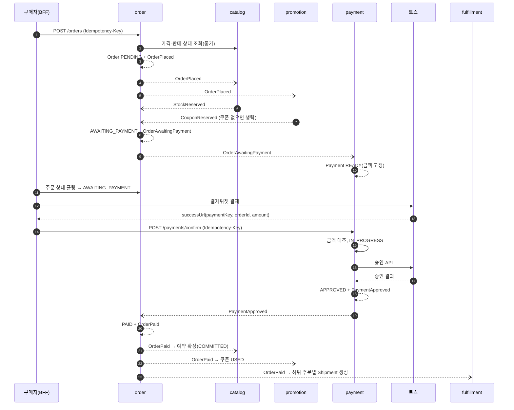
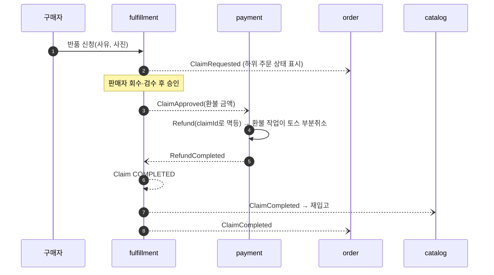

# 메시징과 Saga

이벤트 목록은 [context-map.md](context-map.md)가 원본이다. 이 문서는 이벤트를 **어떻게** 발행하고 소비하는지 다룬다.

## 발행: Transactional Outbox + Debezium
1. 유스케이스는 도메인 변경과 `outbox_event` INSERT를 **한 트랜잭션**에서 커밋한다. 직접 Kafka로 보내지 않는다. INSERT는 `common-messaging`의 `Outbox.append(aggregateType, aggregateId, type, payload)`로 한다. 트랜잭션 밖에서 부르면 예외가 난다.
2. Debezium Postgres 커넥터가 논리 복제로 모든 서비스 스키마의 `outbox_event` 테이블을 읽는다. 커넥터는 **하나**만 둔다(복제 슬롯 하나). 테이블은 publication `openmarket_outbox`에 들어 있는 것만 읽는다. 서비스의 Flyway가 `outbox_event`를 만들면 Postgres event trigger가 publication에 넣는다([data.md](data.md)). 그래서 서비스를 추가해도 커넥터 설정을 고치지 않는다.
3. Debezium Outbox Event Router(SMT)가 `aggregate_type` 값을 토픽 이름으로 쓴다. `aggregate_id`는 Kafka 키, `payload`는 메시지 값이 된다. 나머지 필드는 헤더로 옮긴다.
4. 발행된 행은 서비스별 정리 작업이 지운다(보관 기간 7일). publication이 INSERT와 UPDATE만 복제하므로 이 DELETE는 커넥터에 오지 않는다.

커넥터 설정은 `infra/debezium/outbox-connector.json`이다. connect 컨테이너가 기동할 때 워커를 띄운 뒤 `PUT /connectors/outbox/config`로 등록한다(`start.sh`). connect의 healthy는 커넥터 태스크가 RUNNING이라는 뜻이다.
| 설정 | 값 | 이유 |
|---|---|---|
| `snapshot.mode` | `when_needed` | 오프셋이 없거나, 슬롯이 `max_slot_wal_keep_size`를 넘어 무효가 됐을 때만 스냅샷을 찍는다. 스냅샷은 남아 있는 outbox 행을 다시 보내지만 소비자가 멱등이라 괜찮다 |
| `heartbeat.interval.ms`, `heartbeat.action.query` | 10초, `debezium.heartbeat` 행 UPDATE | outbox에 쓰기가 없고 다른 테이블만 바뀌면 Debezium이 LSN을 확인하지 못해 WAL이 쌓인다. heartbeat 행 변경으로 LSN을 앞으로 민다. 이 변경 이벤트는 `Filter` SMT가 버린다 |
| `key.converter`, `value.converter` | `StringConverter` | 키는 `aggregate_id` 문자열, 값은 `payload`(jsonb) 원문 JSON이다 |
| `header.converter` | `SimpleHeaderConverter` | 헤더를 UTF-8 문자열로 쓴다(아래 "이벤트 형식") |
| `table.op.invalid.behavior` | `fatal` | outbox 행 UPDATE는 버그다. 경고만 남기고 넘어가지 않고 커넥터를 멈춘다 |
| `extended.headers.enabled` | `false` | Debezium 3.x가 붙이는 `__debezium.context.*` 헤더(OpenLineage용)를 끈다. 헤더는 아래 "이벤트 형식"의 다섯 개만 둔다 |
| `producer.override.max.block.ms` | 30초 | 없는 토픽에 쓰면 기본값으로는 프로듀서가 끝없이 기다린다. 태스크 상태는 RUNNING으로 남고 뒤의 모든 이벤트가 멈춘다. 30초 뒤 태스크를 FAILED로 만들어 드러낸다 |
| 비밀번호 | `${env:DEBEZIUM_DB_PASSWORD}` | Connect 워커의 `EnvVarConfigProvider`가 푼다. 등록된 설정에는 자리 표시자만 남는다 |

워커 설정(compose 환경 변수)으로 `scheduled.rebalance.max.delay.ms=0`을 둔다. Kafka가 잠깐 끊겼다 돌아오면 워커가 그룹에 다시 들어온다. 기본값(5분)이면 그동안 태스크를 다시 받지 못해 발행이 멈춘다. 워커가 하나라 기다릴 이유가 없다.

장애 때 동작(R5에서 확인, [risks.md](risks.md))
- 커넥터나 Kafka가 멈춘 동안 쓴 outbox 행은 재기동 뒤 모두 발행된다. 유실이 없다.
- 선언하지 않은 토픽으로 쓰면 30초 뒤 태스크가 FAILED가 되고 connect가 unhealthy로 바뀐다. 오프셋을 커밋하지 않았으므로 유실은 없다. `infra/kafka/topics.txt`에 선언해 토픽을 만든 뒤 `curl -X POST localhost:8083/connectors/outbox/tasks/0/restart`로 재시작하면 이어서 보낸다.
- 스냅샷이나 재시작은 이미 보낸 이벤트를 같은 `id`로 다시 보낼 수 있다. 소비자가 `id`로 거른다.

`outbox_event` 테이블 형식은 [data.md](data.md)에 있다.

## 토픽
| 항목 | 규칙 |
|---|---|
| 이름 | `<발행 서비스>.<집계>`, 소문자 kebab-case. 예: `order.order`, `promotion.issued-coupon` |
| 키 | 집계 ID. 같은 집계의 이벤트 순서를 보장한다 |
| 파티션 | 로컬은 3개. 소비자 동시성은 파티션 수 이하로 둔다 |
| 보관 | 7일 |
| DLT | `<토픽>.DLT`, 원본과 같은 파티션. 파티션 수를 원본과 같게 둔다. `common-messaging`이 이름을 정한다(spring-kafka 4 기본값 `<토픽>-dlt`를 쓰지 않는다) |
| 생성 | 자동 생성을 끈다. `infra/kafka/topics.txt`에 선언하고, Compose 기동 때 `kafka-init` 컨테이너가 없는 토픽만 만든다. DLT와 Debezium heartbeat 토픽(`__debezium-heartbeat.openmarket`)도 여기에 선언한다 |

## 이벤트 형식
메시지 값(JSON)은 이벤트 페이로드만 담는다. 공통 필드는 헤더로 보낸다.

| 헤더 | 출처 | 설명 |
|---|---|---|
| `id` | outbox `id` | 이벤트 ID(UUID v7). 멱등 소비 키 |
| `type` | outbox `type` | 이벤트 이름. 예: `OrderPlaced` |
| `occurredAt` | outbox `occurred_at` | 발생 시각(ISO-8601 UTC) |
| `schemaVersion` | outbox `schema_version` | 페이로드 버전. 하위 호환이 깨지면 올린다 |
| `traceparent` | outbox `traceparent` | W3C 트레이스 컨텍스트. 소비자가 이어 받는다 |
| `dlt-target-group` | DLT 재처리 | 관리자가 다시 보낸 메시지에만 있다. 이 그룹만 처리한다(아래 "DLT 재처리") |

헤더 값은 UTF-8 문자열이다. Outbox Event Router가 `id`를 헤더로 넣고, `table.fields.additional.placement`가 나머지 컬럼을 위 이름으로 옮긴다. `SimpleHeaderConverter`가 문자열로 쓴다.
- `id`: UUID 문자열
- `occurredAt`: Debezium이 `timestamptz`를 ISO-8601 UTC 문자열로 바꾼다(예: `2026-10-18T03:04:05.123456Z`)
- `schemaVersion`: 정수를 문자열로 쓴다(예: `1`)
- `traceparent`: 트레이스가 없을 때 쓴 행이면 값이 비어 있다

소비 쪽 `common-messaging`은 헤더와 페이로드를 `EventEnvelope<T>`로 묶어 리스너에 넘긴다.

스키마 규칙
- 직렬화는 JSON(Jackson)이다. 스키마 레지스트리는 쓰지 않는다.
- 하위 호환 변경(필드 추가)만 허용한다. 소비자는 모르는 필드를 무시한다.
- 필드를 빼거나 의미를 바꿔야 하면 `schemaVersion`을 올리고, 소비자가 두 버전을 모두 처리하게 한 뒤 발행자를 바꾼다.
- 발행 쪽 페이로드 타입과 소비 쪽 타입은 공유 라이브러리로 묶지 않는다. 각 서비스가 자기 타입을 둔다. 형식이 맞는지는 발행자가 JSON 예시(`src/test/resources/events/<type>.json`)를 두고, 소비자 테스트가 같은 예시를 읽어 확인한다.

## 소비: 멱등 소비자
리스너(`ui.event`)는 받은 `ConsumerRecord`를 `common-messaging`의 `IdempotentEventProcessor.process(listener, record, payloadType, handler)`에 넘긴다. 이 메서드가 아래 1~3을 한다. `listener`는 `processed_event.consumer`에 들어가는 리스너 이름이고 `<서비스>.<이벤트>` 형식으로 짓는다(예: `catalog.order-placed`).

1. 리스너는 트랜잭션을 연다.
2. 같은 트랜잭션에서 `processed_event`에 `(event_id, consumer)`를 INSERT한다. 키가 겹치면 이미 처리한 것이므로 건너뛴다.
3. 도메인 처리를 하고, 필요하면 새 이벤트를 outbox에 넣는다. 그다음 커밋한다.
4. 커밋한 뒤 오프셋을 커밋한다(at-least-once).

오류 처리
`common-messaging`의 자동설정(`KafkaConsumerAutoConfiguration`)이 Spring Kafka `DefaultErrorHandler`를 등록하고, Boot가 만드는 리스너 컨테이너 팩토리가 이를 쓴다. 서비스가 `CommonErrorHandler` 빈을 직접 두면 그쪽이 이긴다.
- 일시 오류(DB 연결, 타임아웃 등 아래 영구 오류가 아닌 예외): 같은 메시지를 1초, 2초, 4초 뒤 다시 처리한다(재시도 3회, 처리 4번). 그래도 실패하면 DLT로 보낸다. 재시도하는 동안 그 파티션의 뒤 메시지는 기다린다.
- 영구 오류: 재시도하지 않고 바로 DLT로 보낸다. 헤더가 빠졌거나 페이로드를 읽을 수 없으면 `common-messaging`이 `InvalidEventException`을 던진다. Spring Kafka가 재시도하지 않는 예외(역직렬화 실패, 메시지 변환 실패 등)도 같다. 도메인 규칙 위반이 영구 오류라면 서비스는 예외를 던지지 않고 실패 이벤트를 내거나 무시한다(아래).
- DLT 메시지는 원본 키, 값, 헤더를 그대로 갖고, Spring Kafka가 예외 정보 헤더(`kafka_dlt-exception-cause-fqcn`, `kafka_dlt-exception-message`, `kafka_dlt-original-offset` 등)를 더한다.
- DLT 전송이 실패하면 오프셋을 넘기지 않고 같은 메시지를 다시 처리한다. 유실하지 않는다.
- 처리 실패(WARN), DLT 전송(ERROR), DLT 전송 실패(ERROR)는 로그로 남는다. 로그에는 위치(`토픽-파티션@오프셋`), 이벤트 `type`·`id`, 예외 클래스만 쓴다. 키, 값, 예외 메시지는 개인정보가 들어갈 수 있어 쓰지 않는다.
- 처리 기록(`processed_event`)은 핸들러와 같은 트랜잭션이라 실패한 처리에는 남지 않는다. DLT에서 다시 보낸 메시지는 처음 보는 이벤트로 처리된다.
- 비즈니스 실패는 예외가 아니다. 예를 들어 재고 부족은 `StockReservationFailed` 이벤트로 발행한다.
- DLT 메시지는 관리자 화면에서 보고 다시 처리한다(ADM-5). 아래 "DLT 재처리".

소비자 설정(`infra/config-repo/application.yml`)
| 설정 | 값 | 이유 |
|---|---|---|
| `spring.kafka.bootstrap-servers` | `${KAFKA_BOOTSTRAP_SERVERS:localhost:9092}` | IDE로 띄운 서비스는 호스트 리스너, 컨테이너는 compose가 넣는 `kafka:29092` |
| `spring.kafka.consumer.auto-offset-reset` | `earliest` | 소비자 그룹이 처음 붙을 때 남아 있는 이벤트부터 읽는다. 기본값 `latest`면 서비스가 처음 뜨기 전에 발행된 이벤트를 놓친다 |
| `spring.kafka.listener.observation-enabled` | `true` | `traceparent` 헤더로 소비 스팬을 이어 연다([observability.md](observability.md)) |
| `spring.kafka.template.observation-enabled` | `true` | DLT 전송 스팬. 서비스는 Kafka로 직접 발행하지 않으므로 템플릿은 DLT 전송에만 쓴다 |
| 오프셋 커밋 | Spring Kafka 기본(`BATCH`, 자동 커밋 끔) | 처리한 뒤에 커밋한다. 커밋 전에 죽으면 다시 받지만 멱등 소비가 거른다 |

순서
- 순서는 같은 키(집계) 안에서만 보장된다. 다른 집계의 이벤트 순서에 기대지 않는다.
- 상태 전이가 맞지 않는 이벤트가 오면(예: `PAID`가 아닌 주문에 `ShipmentShipped` 도착) 경고 로그를 남기고 무시한다. 무시한 이벤트는 지표로 센다.

## DLT 재처리
관리자가 DLT 메시지를 보고 다시 처리하거나 버린다(ADM-5, M6). 근거는 [ADR 0022](../adr/0022-dead-letter-reprocessing.md), 화면이 여러 서비스를 합치는 방법은 [ADR 0023](../adr/0023-admin-ops-queries.md)이다.

수집
- `common-messaging`의 DLT 수집기가 서비스마다 하나 돈다. 그 서비스의 리스너가 구독하는 토픽의 DLT(`<토픽>.DLT`)를 그룹 `<서비스>-dead-letter`로 읽는다. 구독 토픽은 기동할 때 리스너 등록 정보에서 얻는다.
- 헤더 `kafka_dlt-original-consumer-group`이 그 서비스의 리스너 그룹인 메시지만 `dead_letter` 테이블([data.md](data.md#dead_letter))에 넣는다. 다른 그룹 메시지는 넘긴다.
- `(DLT 토픽, 파티션, 오프셋)`이 이미 있으면 넣지 않는다. 수집기가 같은 메시지를 다시 읽어도 한 행이다.
- 넣지 못하면(DB 장애) 오프셋을 넘기지 않고 5초마다 다시 시도한다. 실패할 때마다 경고 로그를 남긴다. 모은 메시지도 경고 로그(DLT 위치, 그룹)를 남긴다.
- 수집기는 리스너처럼 `spring.kafka.listener.auto-startup`을 따르고, 서비스 이름(`spring.application.name`)이 있어야 켜진다. DLT 토픽을 직접 읽는 리스너는 수집 대상이 아니다.
- DLT 토픽 보관 기간(7일)과 상관없이 행이 남는다. 처리가 끝난 행(`RETRIED`, `DISCARDED`)은 30일 뒤 정리 작업이 지운다. `PENDING`은 지우지 않는다.

다시 처리
- 관리자가 `PENDING` 행을 다시 보내면, 저장한 키·값·원래 헤더로 원래 토픽의 원래 파티션에 보낸다. 헤더 `dlt-target-group`에 실패한 그룹을 더하고, `kafka_dlt-*` 헤더는 뺀다. 보낸 뒤 행을 `RETRIED`로 바꾼다.
- `IdempotentEventProcessor`는 `dlt-target-group`이 있고 지금 리스너의 그룹이 아니면 처리하지 않고 넘긴다. 다른 그룹은 처리 기록(30일 보관)이 지워진 뒤에도 다시 처리하지 않는다.
- 대상 그룹은 처리 기록이 없으므로(실패한 처리는 롤백됨) 처음 보는 이벤트로 처리한다. 또 실패하면 새 DLT 메시지가 되어 새 행으로 들어온다. 같은 이벤트 ID의 행을 함께 보여 준다.
- 버리기는 사유가 있어야 하고 행을 `DISCARDED`로 바꾼다. 메시지는 보내지 않는다.
- 다시 보내기와 버리기는 행을 잠그고 `PENDING`인지 확인한다. 같은 요청이 겹쳐도 한 번만 보낸다. Kafka 전송이 실패하면 상태를 바꾸지 않고 오류를 돌려준다. 전송은 됐는데 상태 저장이 실패하면 한 번 더 보낼 수 있고, 대상 그룹의 멱등 소비가 거른다.
- 두 작업은 감사 로그(`DEAD_LETTER_RETRIED`, `DEAD_LETTER_DISCARDED`)를 남긴다.
- 다시 보낸 메시지는 같은 키의 뒤 이벤트보다 늦게 도착한다. 그 사이 집계 상태가 바뀌었으면 소비자가 상태 전이 규칙(위 "순서")대로 무시한다.

관리자 API(서비스마다, `common-messaging`)
| 메서드 | 경로 | 내용 |
|---|---|---|
| GET | `/v1/admin/dead-letters?status&topic&before&size` | 목록(쌓인 시각 내림차순, 커서 `{items, nextCursor}`). `status`는 `PENDING`·`RETRIED`·`DISCARDED`, `topic`은 원래 토픽, `size`는 1~100(기본 20). 항목은 ID, 그룹, 이벤트 `id`·`type`, 원래 토픽·파티션·오프셋, 예외 클래스, trace id, 상태, 쌓인 시각, 다시 보내거나 버린 시각·사람·사유 |
| POST | `/v1/admin/dead-letters/{id}/retry` | 다시 보내기. 204. 이미 처리한 행이면 409 `DEAD_LETTER_NOT_PENDING`. 전송이 10초 안에 끝나지 않거나 실패하면 503 `DEAD_LETTER_PUBLISH_FAILED`(상태는 그대로) |
| POST | `/v1/admin/dead-letters/{id}/discard` | 버리기(`{reason}`, 1~500자). 204. 상태 검사는 다시 보내기와 같다 |

- 없는 행은 404 `DEAD_LETTER_NOT_FOUND`, 형식이 틀린 상태·크기·커서·사유는 400 `DEAD_LETTER_INVALID_INPUT`이다.
- `ADMIN` 역할 검사는 서비스의 보안 설정이 한다(common-security). auth는 자기 `/v1/**` 체인에서 같은 규칙을 둔다([auth.md](auth.md) "인가").
- 감사 로그의 대상은 `DEAD_LETTER`와 행 ID다. 다시 보내기는 원래 토픽·파티션, 버리기는 사유를 부가 설명에 남긴다.

- 페이로드와 예외 메시지는 응답에 넣지 않는다. 개인정보가 들어갈 수 있다(NFR-7). 원인은 trace id로 로그와 트레이스에서 찾는다.

## 주문·결제 Saga (코레오그래피)
중앙 오케스트레이터 없이 각 서비스가 이벤트에 반응한다. 주문 상태는 order가 소유한다.

### 정상 흐름

order는 `OrderPlaced`를 낸 뒤, 쿠폰이 있으면 `StockReserved`와 `CouponReserved` 두 개를 다 받아야 `AWAITING_PAYMENT`로 간다. 어느 쪽이 먼저 와도 된다. 받은 결과는 주문에 따로 기록하고, 둘째 결과를 받은 트랜잭션이 상태를 바꾼다([order.md](order.md) "예약 결과"). 할인 금액은 주문할 때 promotion에 동기로 조회해 고정하고, 예약은 쿠폰이 아직 쓸 수 있는지만 본다([promotion.md](promotion.md)).

### 실패와 보상
| 상황 | 처리 |
|---|---|
| 재고 부족(`StockReservationFailed`) 또는 쿠폰 사용 불가(`CouponReservationFailed`) | order가 `CANCELLED`(사유 `STOCK_UNAVAILABLE` 또는 `COUPON_UNAVAILABLE`)로 바꾸고 `OrderCancelled`를 낸다. 다른 쪽 결과를 기다리지 않는다. catalog와 promotion은 받은 예약이 있으면 푼다. 예약이 없으면 아무것도 하지 않는다. 두 서비스는 `OrderPlaced`를 `OrderCancelled`보다 먼저 받으므로(같은 키), 늦게 예약한 쪽도 이어서 푼다 |
| 결제 기한(주문 후 15분) 초과 | order의 만료 작업이 결제 전 주문을 취소 사유 `PAYMENT_TIMEOUT`으로 취소하고 `OrderCancelled`를 낸다([order.md](order.md) "만료와 결제 전 취소") |
| 결제 전 구매자 취소 | order가 취소 사유 `BUYER_CANCELLED`로 취소하고 `OrderCancelled`를 낸다. 이후 처리는 만료와 같다 |
| `OrderCancelled` 수신 시 payment가 `READY` 또는 `FAILED` | 결제를 `CANCELLED`로 바꾼다. 이후 승인 요청은 거부된다(409 `PAYMENT_CANCELLED`) |
| `OrderCancelled` 수신 시 payment가 `IN_PROGRESS` 또는 `APPROVED` | 취소 요청 표시를 남긴다. 승인되면 취소 작업(1분)이 토스 전액 취소를 호출하고 `PaymentCancelled`를 낸다(PAY-3). order는 이미 `CANCELLED`라 `PaymentApproved`를 무시한다([payment.md](payment.md) "보상 취소") |
| 토스 승인 응답 타임아웃 | 승인을 실패로 보지 않는다. 결제 조회 API로 상태를 확인한다. 확인이 안 되면 `IN_PROGRESS`로 두고 재조회 작업이 처리한다 |
| 토스 승인 거절 | `FAILED` + `PaymentFailed`. 주문은 `AWAITING_PAYMENT`로 남아 만료 전까지 다시 결제할 수 있다 |

같은 주문에 대한 승인과 취소가 경쟁하지 않도록, payment는 `Payment` 행을 비관적 락(`SELECT … FOR UPDATE`)으로 잡고 상태를 바꾼다.

## 클레임 환불 흐름

- 발송 전 취소(`CANCEL`)는 신청과 동시에 승인된다. 배송은 취소 상태가 된다.
- 교환(`EXCHANGE`)은 환불하지 않는다. 회수 검수 후 새 `Shipment`를 만들고, 새 배송을 발송하면 `ClaimCompleted`다.
- 환불 금액은 fulfillment가 계산해 `ClaimApproved`에 싣는다. 계산식은 [fulfillment.md](fulfillment.md) "환불 금액"에 있다(2026-10-21 확정).
- `RefundFailed`면 클레임은 `APPROVED`로 남고, 관리자 알림이 간다. 관리자가 payment에서 재시도한다. 보상 취소를 토스가 거절한 결제(`cancel_failure_code`)도 같은 관리자 화면에서 재시도한다.
- 쿠폰 복원: 결제 전 취소(`OrderCancelled`)만 promotion이 복원한다. 결제 후 클레임은 하위 주문이 모두 취소·반품돼도 쿠폰을 돌려주지 않고, 하위 주문에 나눈 할인을 뺀 결제 금액을 환불한다(2026-10-22 결정, [promotion.md](promotion.md) "범위 결정").

## 시간 기반 작업
| 작업 | 서비스 | 주기 |
|---|---|---|
| 주문 만료 | order | 1분 |
| 결제 상태 재조회(`IN_PROGRESS`) | payment | 1분 |
| 결제 보상 취소(취소된 주문의 승인 결제) | payment | 1분 |
| 배송 시뮬레이터(발송 → 배송 중 → 배송 완료) | fulfillment | 1분 |
| 자동 구매확정(배송 완료 + 7일) | fulfillment | 1시간 |
| 환불(토스 부분취소, `RefundJob`) | payment | 1분 |
| 주간 정산 확정(끝난 지 3시간 지난 정산 기간) | settlement | 매주 월요일 03:00 |
| 미첨부 파일 삭제 | file | 1시간 |
| 발행된 outbox 행(7일), `processed_event`(30일), 처리가 끝난 `dead_letter`(30일, M6) 정리 | 각 서비스(`common-messaging`) | 매일 04:00 |
| 멱등성 키 기록 정리(24시간) | 각 서비스(`common-web`) | 1시간 |

인스턴스가 여러 개여도 한 번만 실행되도록 ShedLock을 쓴다. 각 작업은 다시 실행해도 결과가 같아야 한다.
- `common-messaging`이 스케줄링을 켜고 락 실행기(`LockingTaskExecutor`)와 `shedlock` 테이블을 제공한다.
- 서비스의 스케줄 작업도 `@Scheduled` 메서드 안에서 이 실행기로 감싼다. 락 이름은 `<서비스>-<작업>`이다.
