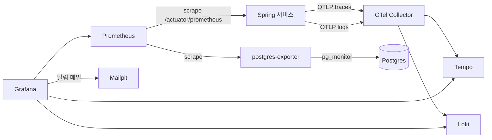

# 관측성

목표(NFR-10): 요청 하나를 gateway부터 Kafka 소비자까지 트레이스 하나로 따라간다. 서비스마다 RED 지표를 본다. 로그와 트레이스를 trace id로 오간다.

## 구성 (Compose `obs` profile)

- 트레이스: Micrometer Tracing의 OTel 브리지로 만들고 OTLP(HTTP 4318)로 Collector에 보낸다. 로컬은 모든 요청을 남긴다(샘플링 1.0). Java agent는 쓰지 않고 Spring Boot 4의 OpenTelemetry 스타터(`spring-boot-starter-opentelemetry`)로 구성한다. 서비스는 스타터를 `common-observability`로 받는다. `common-messaging`이 Micrometer `Tracer`·`Propagator`로 `traceparent`를 만들고, 이 조합으로 테스트했다.
- 지표: Micrometer → Prometheus 스크레이프. 서비스 목록은 Eureka 서비스 디스커버리로 찾는다. 서비스가 내는 지표는 아래 "지표", 복제 슬롯은 postgres-exporter가 낸다.
- 로그: 표준 출력과 OTLP 양쪽으로 낸다.
  - OTLP: `common-observability`가 루트 로거에 OpenTelemetry Logback 어펜더를 붙인다. 레코드에 그때 스팬의 trace id·span id가 들어가고, Loki에서 `service_name` 라벨과 `trace_id` 구조화 메타데이터가 된다. 어펜더는 스프링 빈이 만들어질 때 붙으므로 그 전의 기동 로그(설정 읽기, Flyway 등)는 표준 출력에만 남는다. Boot는 이 어펜더를 포함하지 않는다(ADR 0009).
  - 표준 출력: 컨테이너는 JSON 구조화 로그(Boot 구조화 로깅, ECS 형식)를 한 줄씩 낸다(compose의 `LOGGING_STRUCTURED_FORMAT_CONSOLE`). IDE·bootRun은 Boot 기본 텍스트 로그이고, 줄마다 `[traceId-spanId]`가 들어간다.
- Next.js 서버도 OTel을 붙여 BFF → gateway 구간을 같은 트레이스로 잇는다(M1).
- gateway는 응답 헤더 `X-Request-Id`로 trace id를 돌려준다. 오류를 신고받으면 이 값으로 로그와 트레이스를 찾는다.

## 설정 위치
| 파일 | 내용 |
|---|---|
| `infra/config-repo/application.yml` | 트레이스·로그 내보내기 주소(`management.opentelemetry.{tracing,logging}.export.otlp.endpoint`, 호스트는 `OTEL_COLLECTOR_HOST`), 샘플링(`management.tracing.sampling.probability`) |
| `infra/compose/obs.yaml` | 컨테이너 정의. 포트는 [dev-setup.md](../dev-setup.md) |
| `infra/observability/otel-collector.yaml` | OTLP 수신(4317, 4318) → 트레이스는 Tempo, 로그는 Loki(`/otlp`). 지표 파이프라인은 없다 |
| `infra/observability/tempo.yaml` | 단일 바이너리 모드, 로컬 디스크 저장, 보존 7일 |
| `infra/observability/loki.yaml` | 단일 바이너리 모드, 로컬 디스크 저장, 보존 7일. OTLP 로그의 `trace_id`는 구조화 메타데이터로 들어간다 |
| `infra/observability/prometheus.yml` | 스크레이프 대상. 보존 7일, exemplar 저장 켬. 관측성 스택, postgres-exporter(잡 `postgres`), discovery는 고정 대상으로, Spring 서비스는 Eureka 서비스 디스커버리(잡 `services`, 라벨 `application`)로 찾는다. IDE로 띄운 서비스는 WSL IP로 등록돼 컨테이너에서 접속된다. 관리 포트를 따로 둔 서비스(gateway 8081)는 Eureka 메타데이터 `management.port`로 주소를 바꾼다 |
| `infra/config-repo/application.yml` `management.metrics.distribution` | HTTP 서버 지표의 히스토그램 버킷(5ms~10s). p95 패널과 알림이 쓴다 |
| `infra/postgres/init/03-monitor.sh` | postgres-exporter 계정 `monitor`(`pg_monitor` 역할, 비밀번호 `MONITOR_DB_PASSWORD`) |
| `infra/grafana/provisioning/dashboards` | 대시보드 JSON(`openmarket/`), 폴더 "Open Market" |
| `infra/grafana/provisioning/alerting/alerts.yaml` | 알림 규칙, 연락처(Mailpit `ops@openmarket.local`), 알림 정책. SMTP는 obs.yaml의 `GF_SMTP_*` |
| `infra/grafana/provisioning/datasources` | Prometheus, Tempo, Loki. uid를 이름과 같게 고정한다. 지표 exemplar → 트레이스, 트레이스 → 로그, 로그 → 트레이스 링크를 건다. 트레이스 → 로그는 본문 검색이 아니라 `trace_id` 메타데이터로 거른다(`{service_name=~".+"} \| trace_id="<trace id>"`) |

## Kafka 구간 트레이스
- 발행: outbox에 이벤트를 넣을 때 현재 트레이스 컨텍스트를 `traceparent` 컬럼에 담는다. Debezium이 헤더로 옮긴다.
- 소비: Spring Kafka 리스너 관측(`spring.kafka.listener.observation-enabled=true`, config-repo 공통 설정)이 `traceparent` 헤더로 자식 스팬을 연다. 핸들러가 그 안에서 outbox에 쌓은 이벤트에도 같은 트레이스가 들어가 다음 소비자까지 이어진다. 헤더 값이 비어 있으면 새 트레이스로 시작한다. `common-messaging`은 같은 값을 `EventEnvelope.traceparent`로도 넘긴다. 이 동작은 `common-messaging`의 Kafka 통합 테스트가 확인한다.
- 확인(M0-d, 샘플 이벤트 `PingSent`. 샘플은 M1에서 지웠다): gateway `POST /api/member/v1/ping` 요청 하나가 Tempo에서 트레이스 하나로 보인다. gateway 서버 스팬 → 레이트 리밋(Redis) → member 서버 스팬 → member `member.ping process`(소비) 순서이고, 응답 헤더 `X-Request-Id`가 그 trace id다. 같은 레코드를 다시 소비한 스팬도 같은 트레이스에 붙는다. 그 trace id로 Loki를 거르면 member의 요청 로그와 리스너 처리 로그가 각 스팬 id와 함께 나온다.
- 결과: 주문 생성 요청 하나에서 `OrderPlaced` → 재고 예약 → `StockReserved` → 결제 대기까지 한 트레이스로 보인다.

## 지표
Boot가 내는 HTTP(`http_server_requests_seconds`), JVM, Hikari, Kafka 클라이언트 지표에 더해 아래를 쓴다. 결정과 대안은 [ADR 0025](../adr/0025-ops-metrics-and-alerts.md)에 있다.

| 지표(Prometheus 이름) | 내는 곳 | 뜻 |
|---|---|---|
| `messaging_outbox_events_total{type}` | `common-messaging` `JdbcOutbox` | 커밋된 outbox 이벤트 수. 롤백되면 세지 않는다. 주문 생성(`OrderPlaced`), 결제 승인·실패(`PaymentApproved`, `PaymentFailed`) 수다 |
| `messaging_dead_letters_total{topic, group}` | `common-messaging` 오류 처리기(`FailedEventLogger`) | DLT로 보낸 메시지 수. `topic`은 원래 토픽, `group`은 실패한 리스너 그룹 |
| `messaging_event_delay_seconds{listener}` | `IdempotentEventProcessor` | 이벤트를 outbox에 쌓은 시각부터 리스너가 처리를 마칠 때까지(히스토그램 10ms~10분). 이미 처리한 이벤트는 재지 않는다. Saga 단계별 시간이다 |
| `messaging_events_ignored_total{listener}` | 유스케이스의 `IgnoredEvents.warn(log, ...)` | 상태 전이가 맞지 않아 처리하지 않고 넘긴 이벤트([messaging.md](messaging.md) "순서"). 리스너가 처리하는 중에만 센다 |
| `kafka_consumer_fetch_manager_records_lag_max{client_id}` | Boot Kafka 지표(소비자) | 소비자마다 맡은 파티션 중 가장 큰 lag. 토픽 라벨은 없다. 소비자가 살아 있을 때만 보인다 |
| `jvm_threads_virtual_*` | `micrometer-java21`(`common-observability`) | 살아 있는 가상 스레드 수, 고정(pinned) 시간, 제출 실패 |
| `pg_replication_slots_*` | postgres-exporter | 슬롯 활성, `wal_status`(`reserved`, `extended`, `unreserved`, `lost`), 현재 LSN, 확인된 LSN, 잃기 전까지 남은 WAL |

라벨 `application`은 Prometheus가 Eureka 앱 이름으로 붙인다.

## 대시보드와 알림
Grafana 폴더 "Open Market"(http://localhost:3003). 알림은 7종이다.

| 대시보드(uid) | 내용 |
|---|---|
| 서비스 RED(`openmarket-red`) | 요청 수, 5xx 비율, p50/p95/p99(서비스별), 4xx, 엔드포인트별 초당 요청·p95·5xx 표 |
| JVM(`openmarket-jvm`) | 힙(상한 대비), GC 멈춤·횟수, 플랫폼·가상 스레드 수, 가상 스레드 고정 시간·제출 실패, 커넥션 풀 사용·대기·획득 시간(최대, 평균), CPU |
| Kafka와 outbox(`openmarket-kafka`) | 소비자별 최대 lag, 이벤트 처리 지연 p95(리스너별), DLT 유입, 무시한 이벤트, 처리한 이벤트, outbox 이벤트, 복제 슬롯 미확인 WAL·활성·WAL 상태·남은 WAL |
| 비즈니스(`openmarket-business`) | 주문 생성, 결제 승인·실패, 쿠폰 발급(기간 합계), 주문 흐름(생성 → 결제 대기 → 결제 완료·취소), 결제, 쿠폰 발급 응답, 재고·쿠폰 예약, Saga 단계별 지연 p95 |

업무 숫자의 원본은 admin 운영 지표다(업무 DB, [ADR 0023](../adr/0023-admin-ops-queries.md)). 비즈니스 대시보드는 흐름과 지연을 본다.

알림은 Grafana 알림으로 Mailpit(http://localhost:8025, 받는 주소 `ops@openmarket.local`)에 보낸다. 30초마다 평가하고, 같은 알림은 4시간마다 다시 보낸다. 풀리면 해결 메일이 간다.

| 알림 | 조건 | 지속 | 먼저 볼 곳 |
|---|---|---|---|
| 오류율 급증 | 서비스별 5분 5xx 비율 > 5%(초당 0.1건 이상일 때) | 2분 | RED 엔드포인트 표, `X-Request-Id`로 Tempo·Loki |
| p95 지연 목표 초과 | 서비스별 5분 p95 > 500ms(NFR-9 주문 생성 기준) | 5분 | RED 엔드포인트별 p95, JVM GC·커넥션 대기 |
| 소비자 지연 증가 | 서비스별 소비자 lag 최대 > 1,000 | 5분 | Kafka 이벤트 처리 지연, 서비스 오류, 커넥션 풀 |
| DLT 유입 | 10분 안에 DLT로 보낸 메시지가 있다(서비스·토픽·그룹별) | 바로 | admin "DLT 메시지" 화면 |
| outbox 미발행 증가 | 복제 슬롯 미확인 WAL > 16MiB | 3분 | connect 상태, 커넥터 상태 |
| 복제 슬롯 무효 | 슬롯 `openmarket_outbox`가 `lost` 또는 `unreserved`(곧 lost) | 30초 | 런북 "복제 슬롯 무효". 저절로 복구되지 않는다(R5, R16) |
| 복제 슬롯 없음 | 슬롯 `openmarket_outbox`가 없거나 postgres-exporter가 응답하지 않는다 | 3분 | connect 상태, 커넥터 등록, `up{job="postgres"}` |

DLT 카운터는 처음 DLT로 보낼 때 1로 생겨 `increase()`가 0이 되므로, 10분 전에 없던 시계열도 유입으로 본다. 새 스택은 Debezium이 슬롯을 만들기 전 1~2분 동안 슬롯이 없어서 "복제 슬롯 없음"은 3분을 둔다. `infra/fault/run.sh slot`이 "복제 슬롯 무효" 경보 메일과 복구 뒤 해결 메일이 Mailpit에 오는지 확인한다.

## 보안 이벤트
로그인과 접근 거부를 WARN 로그로 남긴다(NFR-6, A09). 로거 이름은 `security`이고 메시지는 `보안 이벤트 <이벤트> ...`라서 Loki에서 `|= "보안 이벤트"`로 모아 본다. 이메일 원문, 토큰, 쿼리 문자열은 남기지 않는다.

| 이벤트 | 남기는 곳 | 내용 |
|---|---|---|
| `LOGIN_FAILED` | auth `LoginAttemptRecorder` | 계정 ID(없는 계정이면 `unknown`), IP |
| `ACCOUNT_LOCKED` | auth(비밀번호·2단계 실패) | 이번 실패로 15분 잠근 계정 ID, IP |
| `SECOND_FACTOR_FAILED` | auth `SecondFactorPageController` | 2단계 코드(또는 복구 코드)가 틀린 계정 ID, IP |
| `LOGIN_RATE_LIMITED` | auth `LoginRateLimitFilter` | 분당 한도를 넘은 IP. 창마다 처음 넘을 때 한 번 |
| `ACCESS_DENIED` | gateway | 역할이나 막은 경로(내부 API, actuator, OpenAPI 문서)로 거절한 403. 주체(`sub`), 메서드, 경로 |
| `TOKEN_REJECTED` | gateway | 토큰이 있는데 서명·`iss`·`aud`·만료 검증에 실패한 401. 메서드, 경로. 토큰 없이 온 401은 남기지 않는다 |

- 서비스 안의 소유권 거절(남의 주문 등)은 업무 오류(404·403 ProblemDetail)라 요청 로그(메서드, 경로, 상태)로 본다.
- 알림 규칙은 아직 두지 않는다. 로그 기반 알림은 Loki 규칙이 필요하다.

## 대시보드 관리
Grafana 데이터 소스와 대시보드는 `infra/grafana/`에 파일로 두고 프로비저닝한다. 화면에서 고친 대시보드는 JSON으로 내보내 커밋한다.
