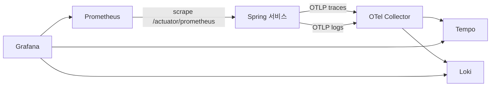

# 관측성

목표(NFR-10): 요청 하나를 gateway부터 Kafka 소비자까지 트레이스 하나로 따라간다. 서비스마다 RED 지표를 본다. 로그와 트레이스를 trace id로 오간다.

## 구성 (Compose `obs` profile)

- 트레이스: Micrometer Tracing의 OTel 브리지로 만들고 OTLP(HTTP 4318)로 Collector에 보낸다. 로컬은 모든 요청을 남긴다(샘플링 1.0). Java agent는 쓰지 않고 Spring Boot 4의 OpenTelemetry 스타터(`spring-boot-starter-opentelemetry`)로 구성한다. 서비스는 스타터를 `common-observability`로 받는다. `common-messaging`이 Micrometer `Tracer`·`Propagator`로 `traceparent`를 만들고, 이 조합으로 테스트했다.
- 지표: Micrometer → Prometheus 스크레이프. 서비스 목록은 Eureka 서비스 디스커버리로 찾는다.
- 로그: 표준 출력과 OTLP 양쪽으로 낸다.
  - OTLP: `common-observability`가 루트 로거에 OpenTelemetry Logback 어펜더를 붙인다. 레코드에 그때 스팬의 trace id·span id가 들어가고, Loki에서 `service_name` 라벨과 `trace_id` 구조화 메타데이터가 된다. 어펜더는 스프링 빈이 만들어질 때 붙으므로 그 전의 기동 로그(설정 읽기, Flyway 등)는 표준 출력에만 남는다. Boot는 이 어펜더를 포함하지 않는다(ADR 0009).
  - 표준 출력: 컨테이너는 JSON 구조화 로그(Boot 구조화 로깅, ECS 형식)를 한 줄씩 낸다(compose의 `LOGGING_STRUCTURED_FORMAT_CONSOLE`). IDE·bootRun은 Boot 기본 텍스트 로그이고, 줄마다 `[traceId-spanId]`가 들어간다.
- Next.js 서버도 OTel을 붙여 BFF → gateway 구간을 같은 트레이스로 잇는다(M1).
- gateway는 응답 헤더 `X-Request-Id`로 trace id를 돌려준다. 오류를 신고받으면 이 값으로 로그와 트레이스를 찾는다.

## 설정 위치
| 파일 | 내용 |
|---|---|
| `infra/config-repo/application.yml` | 트레이스·로그 내보내기 주소(`management.opentelemetry.{tracing,logging}.export.otlp.endpoint`, 호스트는 `OTEL_COLLECTOR_HOST`), 샘플링(`management.tracing.sampling.probability`) |
| `infra/compose/obs.yaml` | 컨테이너 정의. 포트는 [dev-setup.md](../dev-setup.md) |
| `infra/observability/otel-collector.yaml` | OTLP 수신(4317, 4318) → 트레이스는 Tempo, 로그는 Loki(`/otlp`). 지표 파이프라인은 없다 |
| `infra/observability/tempo.yaml` | 단일 바이너리 모드, 로컬 디스크 저장, 보존 7일 |
| `infra/observability/loki.yaml` | 단일 바이너리 모드, 로컬 디스크 저장, 보존 7일. OTLP 로그의 `trace_id`는 구조화 메타데이터로 들어간다 |
| `infra/observability/prometheus.yml` | 스크레이프 대상. 보존 7일, exemplar 저장 켬. 관측성 스택과 discovery는 고정 대상으로, Spring 서비스는 Eureka 서비스 디스커버리(잡 `services`, 라벨 `application`)로 찾는다. IDE로 띄운 서비스는 WSL IP로 등록돼 컨테이너에서 접속된다. 관리 포트를 따로 둔 서비스(gateway 8081)는 Eureka 메타데이터 `management.port`로 주소를 바꾼다 |
| `infra/grafana/provisioning/datasources` | Prometheus, Tempo, Loki. uid를 이름과 같게 고정한다. 지표 exemplar → 트레이스, 트레이스 → 로그, 로그 → 트레이스 링크를 건다. 트레이스 → 로그는 본문 검색이 아니라 `trace_id` 메타데이터로 거른다(`{service_name=~".+"} \| trace_id="<trace id>"`) |

## Kafka 구간 트레이스
- 발행: outbox에 이벤트를 넣을 때 현재 트레이스 컨텍스트를 `traceparent` 컬럼에 담는다. Debezium이 헤더로 옮긴다.
- 소비: Spring Kafka 리스너 관측(`spring.kafka.listener.observation-enabled=true`, config-repo 공통 설정)이 `traceparent` 헤더로 자식 스팬을 연다. 핸들러가 그 안에서 outbox에 쌓은 이벤트에도 같은 트레이스가 들어가 다음 소비자까지 이어진다. 헤더 값이 비어 있으면 새 트레이스로 시작한다. `common-messaging`은 같은 값을 `EventEnvelope.traceparent`로도 넘긴다. 이 동작은 `common-messaging`의 Kafka 통합 테스트가 확인한다.
- 확인(M0-d, 샘플 이벤트 `PingSent`. 샘플은 M1에서 지웠다): gateway `POST /api/member/v1/ping` 요청 하나가 Tempo에서 트레이스 하나로 보인다. gateway 서버 스팬 → 레이트 리밋(Redis) → member 서버 스팬 → member `member.ping process`(소비) 순서이고, 응답 헤더 `X-Request-Id`가 그 trace id다. 같은 레코드를 다시 소비한 스팬도 같은 트레이스에 붙는다. 그 trace id로 Loki를 거르면 member의 요청 로그와 리스너 처리 로그가 각 스팬 id와 함께 나온다.
- 결과: 주문 생성 요청 하나에서 `OrderPlaced` → 재고 예약 → `StockReserved` → 결제 대기까지 한 트레이스로 보인다.

## 대시보드와 알림
| 대시보드 | 내용 |
|---|---|
| 서비스 RED | 요청 수, 오류율, p50/p95/p99 지연 (서비스·엔드포인트별) |
| JVM | 힙, GC, 가상 스레드, 커넥션 풀 |
| Kafka | 소비자 지연(lag), DLT 유입 수, 무시한 이벤트 수 |
| 비즈니스 | 주문 생성 수, 결제 성공·실패, 쿠폰 발급, Saga 단계별 체류 시간 |

알림 규칙(M6): 오류율 급증, p95 목표 초과, 소비자 지연 증가, DLT 유입, outbox 미발행 행 증가. 알림은 Grafana 알림으로 로컬 Mailpit에 보낸다.

## 대시보드 관리
Grafana 데이터 소스와 대시보드는 `infra/grafana/`에 파일로 두고 프로비저닝한다. 화면에서 고친 대시보드는 JSON으로 내보내 커밋한다.
