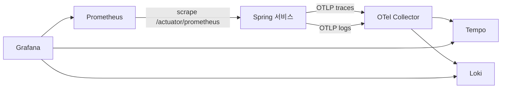

# 관측성

목표(NFR-10): 요청 하나를 gateway부터 Kafka 소비자까지 트레이스 하나로 따라간다. 서비스마다 RED 지표를 본다. 로그와 트레이스를 trace id로 오간다.

## 구성 (Compose `obs` profile)

- 트레이스: Micrometer Tracing의 OTel 브리지로 만들고 OTLP로 Collector에 보낸다. Spring Boot 4의 OpenTelemetry 지원과 Java agent 중 무엇을 쓸지는 M0-b에서 정한다.
- 지표: Micrometer → Prometheus 스크레이프. 서비스 목록은 Eureka 서비스 디스커버리로 찾는다.
- 로그: JSON 구조화 로그(Spring Boot 구조화 로깅). 표준 출력과 OTLP 양쪽으로 낸다. 필드에 `traceId`, `spanId`, `service`가 들어간다.
- Next.js 서버도 OTel을 붙여 BFF → gateway 구간을 같은 트레이스로 잇는다(M1).

## Kafka 구간 트레이스
- 발행: outbox에 이벤트를 넣을 때 현재 트레이스 컨텍스트를 `traceparent` 컬럼에 담는다. Debezium이 헤더로 옮긴다.
- 소비: `common-messaging`의 리스너 래퍼가 `traceparent` 헤더로 자식 스팬을 연다.
- 결과: 주문 생성 요청 하나에서 `OrderPlaced` → 재고 예약 → `StockReserved` → 결제 대기까지 한 트레이스로 보인다.

## 대시보드와 알림
| 대시보드 | 내용 |
|---|---|
| 서비스 RED | 요청 수, 오류율, p50/p95/p99 지연 (서비스·엔드포인트별) |
| JVM | 힙, GC, 가상 스레드, 커넥션 풀 |
| Kafka | 소비자 지연(lag), DLT 유입 수, 무시한 이벤트 수 |
| 비즈니스 | 주문 생성 수, 결제 성공·실패, 쿠폰 발급, Saga 단계별 체류 시간 |

알림 규칙(M6): 오류율 급증, p95 목표 초과, 소비자 지연 증가, DLT 유입, outbox 미발행 행 증가. 알림은 Grafana 알림으로 로컬 Mailpit에 보낸다.

## 대시보드 관리
Grafana 데이터 소스와 대시보드는 `infra/grafana/`에 파일로 두고 프로비저닝한다. 화면에서 고친 대시보드는 JSON으로 내보내 커밋한다.
