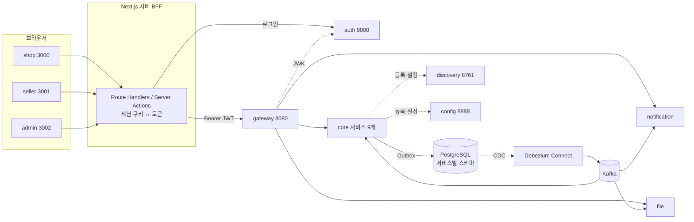

# 아키텍처 개요

## 한눈에 보기

## 서비스 목록
포트 규칙: Gateway 8080, auth 9000, Spring Cloud 인프라는 관례 포트, core는 81xx, 기타 infra는 82xx. 스키마 이름은 서비스 이름과 같다.

### core (`services/core/<name>`)
| 서비스 | 포트 | 스키마 | 책임 | 주요 집계 |
|---|---|---|---|---|
| member | 8101 | member | 회원 프로필, 배송지, 입점 신청·심사, 판매자 | `Member`, `SellerApplication`, `Seller` |
| catalog | 8102 | catalog | 카테고리, 상품, SKU, 재고와 재고 예약 | `Category`, `Product`, `Stock`, `StockReservation` |
| order | 8103 | order | 장바구니, 주문과 하위 주문, 주문 만료 | `Cart`, `Order` |
| payment | 8104 | payment | 토스 결제 승인·취소·환불, 결제 원장 | `Payment` |
| fulfillment | 8105 | fulfillment | 배송, 구매확정, 클레임 | `Shipment`, `Claim` |
| promotion | 8106 | promotion | 쿠폰 정책, 발급, 예약·사용·복원 | `Coupon`, `IssuedCoupon` |
| review | 8107 | review | 리뷰, 답글, 별점 요약 | `Review`, `RatingSummary` |
| settlement | 8108 | settlement | 정산 대상, 주간 정산 배치, 지급 기록, 수수료율 | `SettlementItem`, `Settlement` |
| search | 8109 | search(오프셋·메타만) | Elasticsearch 읽기 모델, 검색, 자동완성 | (ES 인덱스 `products`) |

### infra (`services/infra/<name>`)
| 서비스 | 포트 | 스키마 | 책임 |
|---|---|---|---|
| gateway | 8080 | — | 라우팅, JWT 검증, 레이트 리밋(Redis), CORS, 요청 ID |
| discovery | 8761 | — | Eureka 서버 |
| config | 8888 | — | Spring Cloud Config 서버. 저장소는 `infra/config-repo` (native 백엔드) |
| auth | 9000 | auth | Spring Authorization Server. 계정, 자격 증명, 역할, OAuth2 클라이언트, 토큰 |
| file | 8201 | file | 업로드, 로컬 볼륨 저장, 썸네일, 정적 제공, 미첨부 파일 정리 |
| notification | 8202 | notification | 이메일(Mailpit SMTP), 인앱 알림, 중복 방지 |

### clients (`clients/apps/<name>`)
| 앱 | 포트 | 사용자 | OAuth2 클라이언트 ID |
|---|---|---|---|
| shop | 3000 | 구매자 | `shop` |
| seller | 3001 | 판매자 | `seller` |
| admin | 3002 | 관리자 | `admin` |

## 통신 규칙
1. **외부 진입점은 Gateway 하나**다. 경로는 `/api/<service>/**` → `lb://<service>`로 라우팅한다. 예외: 로그인 흐름은 브라우저가 `auth`에 직접 리다이렉트된다. 공개 이미지는 `/files/**`로 제공한다.
2. **상태 변경은 이벤트로 전파**한다. 서비스는 자기 스키마에 쓰고, 같은 트랜잭션에서 `outbox_event`에 이벤트를 넣는다. Debezium이 Kafka로 발행한다. 자세한 내용은 [messaging.md](messaging.md)에 있다.
3. **동기 호출(OpenFeign)은 조회만** 한다. 예를 들어 order는 주문을 만들 때 catalog에서 가격과 판매 상태를 조회한다. 동기 호출에는 타임아웃, 재시도(조회만), 서킷 브레이커(Resilience4j)를 건다. 서비스 사이 호출에는 클라이언트 자격 증명 토큰(`client_credentials`)을 쓴다.
4. **다른 스키마는 읽지 않는다.** 다른 서비스 데이터가 필요하면 조회 API를 부르거나, 이벤트를 받아 자기 스키마에 읽기 모델을 둔다.
5. **사용자 대면 동기 처리의 예외**: 결제 승인은 사용자가 기다리는 동기 흐름이다. BFF가 payment의 승인 API를 부르고, payment가 토스 API를 동기로 호출한다. 결과는 이벤트로 전파한다.

## 런타임 공통 설정
- Java 25, 가상 스레드 사용(`spring.threads.virtual.enabled=true`).
- `spring.jpa.open-in-view=false`. 지연 로딩은 트랜잭션 안에서만 한다.
- 지표는 Prometheus가 스크레이프한다. OpenTelemetry 스타터의 OTLP 지표 내보내기는 끈다(`management.otlp.metrics.export.enabled=false`). 트레이스와 로그만 OTLP로 보낸다.
- 설정은 config 서버에서 받는다. 공통 설정은 `infra/config-repo/application.yml`, 서비스별 설정은 `<service>.yml`에 둔다. 비밀 값은 환경 변수로 넣는다.
- 모든 서비스는 Eureka에 등록되고, Actuator(`health`, `prometheus`)와 OpenAPI(`/v3/api-docs`)를 노출한다.
- 공통 라이브러리(`services/libs`)
  - `common-core`: 프레임워크 의존 없는 베이스 예외, 오류 분류, `Money`, ID 생성, 개인정보 마스킹
  - `common-web`: 오류 응답 변환, `@Idempotent` 처리, 요청 로깅 (Boot 자동설정)
  - `common-messaging`: Outbox 기록기, 멱등 소비자, 이벤트 봉투
  - `common-test`: Testcontainers 설정, ArchUnit 규칙, 테스트 픽스처
- 버전 조합과 근거는 [ADR 0009](../adr/0009-version-matrix.md)에 있다. 실제 값의 원본은 빌드 파일이다. 다른 문서에는 버전 숫자를 적지 않는다.

## 로컬 실행 구성 (Docker Compose)
`infra/compose`에 profile별로 나눈다. 개발할 때는 인프라만 Compose로 띄우고, 작업 중인 서비스는 IDE나 `bootRun`으로 실행한다. discovery와 config는 어느 서비스든 먼저 필요하므로 기본 profile에 둔다. Spring 서비스 이미지는 `services/Dockerfile` 하나로 만든다. 전체 E2E는 `apps` profile로 모두 띄운다.

| profile | 구성 요소 |
|---|---|
| (기본) | PostgreSQL(`wal_level=logical`), Kafka(KRaft 단일 노드), Debezium Connect, Redis, Mailpit, Kafka UI, discovery, config |
| `search` | Elasticsearch(+ nori 플러그인, M2) |
| `obs` | OpenTelemetry Collector, Prometheus, Tempo, Loki, Grafana |
| `apps` | discovery, config를 뺀 Spring 서비스(빌드 이미지) |

메모리 예산(WSL 할당 기준)과 profile 조합의 실측은 [risks.md](risks.md)에서 관리한다.

## 관련 문서
- [context-map.md](context-map.md): 컨텍스트 관계와 이벤트 목록
- [conventions.md](conventions.md): 패키지 규약과 명명 규칙
- [data.md](data.md), [messaging.md](messaging.md), [auth.md](auth.md), [file.md](file.md), [observability.md](observability.md), [risks.md](risks.md)
